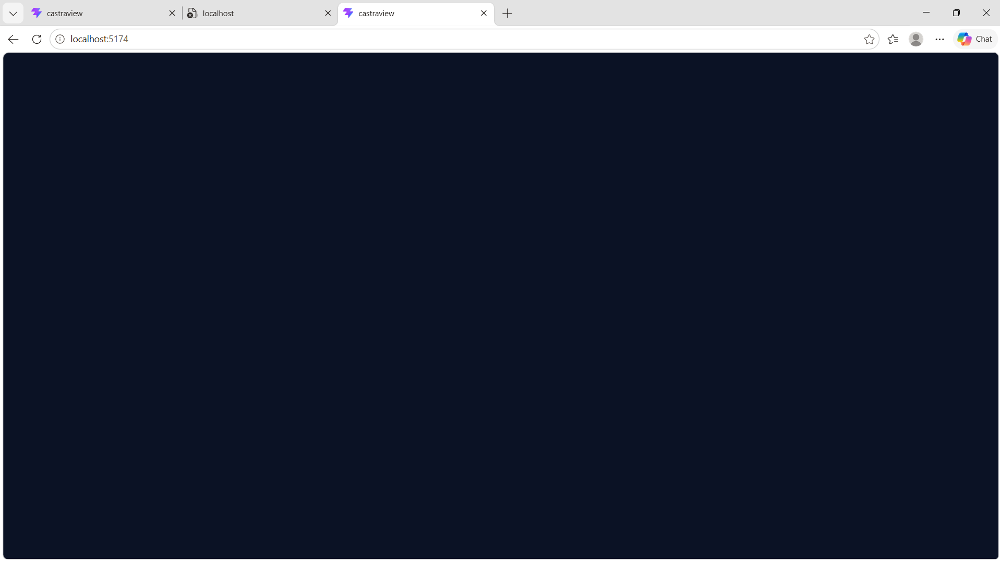

# CLAUDE.md

<<<<<<< HEAD
This file provides guidance to Claude Code (claude.ai/code) when working in this repository.

## Repository architecture

CastraVision is a full-stack marketing assistant:

- `CastraServices/` contains the Django REST API, models, authentication, permissions, campaign/business endpoints, background tasks, and migrations.
- `CastraVision/` contains Django project configuration and URL/WSGI/ASGI entry points.
- `CastraView/` is the React/Vite frontend. `src/main.jsx` mounts `App.jsx`.
- `Utils/`, `Datasources/`, `data/`, `docs/`, and `supabase/` hold supporting utilities, external-data integrations, sample data, documentation, and Supabase-related scripts.
- `.github/workflows/ci.yml` runs backend Ruff/pytest checks and frontend dependency installation, lint, and build checks.

The product flow is layered: users configure business and campaign data, the backend exposes authenticated API operations, AI-oriented services produce strategy/content/budget outputs, and the frontend presents those workflows with role-based access.

## Development commands

Frontend commands run from `CastraView/`:

```bash
npm install
=======
This file provides guidance to Claude Code (claude.ai/code) when working with code in this repository.

## Repository rules

- `AGENTS.md` is the authoritative project instruction. For normal work, only modify `CastraView/` and `docs/UI/`.
- Do not modify backend files, Docker files, `.env` files, or generated `package-lock.json` unless the user explicitly changes that scope.
- Do not run `git commit`, `git push`, `git reset`, or other destructive Git operations.
- The frontend is React 19 + Vite 8 in JavaScript. Follow the existing Tailwind v4/shadcn conventions, use `@/` for `CastraView/src`, and use theme tokens rather than new hard-coded colors.
- New frontend API calls belong in `CastraView/src/services/` or the existing API helpers, not directly in page components. Keep displayed copy consistent with the Vietnamese UI and the supplied designs in `docs/UI/`.
- After frontend changes, run `npm run lint` and `npm run build` from `CastraView/` and report both results.

## Common commands

Run commands from the repository root unless noted otherwise.

### Backend local development

```powershell
# Optional: activate the project virtual environment
.\.venv\Scripts\Activate.ps1

# Use SQLite when PostgreSQL/Docker is not running
$env:DATABASE_URL = ""
python manage.py migrate
python manage.py runserver 127.0.0.1:8000
```

The backend loads the root `.env` through `CastraVision/settings.py`. The legacy
`Utils/supabase_client.py` is imported while URL modules load and requires a non-empty
`SUPABASE_URL` and `SUPABASE_KEY`. The current frontend configuration uses a publishable
key name instead, so a direct local backend run may need a temporary PowerShell alias in
the same terminal:

```powershell
$env:SUPABASE_URL = "https://<project-ref>.supabase.co"
$env:SUPABASE_KEY = "<publishable-key>"
```

Do not commit these values. If the backend is not listening on port 8000, the Vite
frontend reports API calls as `502`; that is a backend startup/proxy symptom, not an
invalid login response.

### Backend tests and checks

```powershell
python manage.py check
pytest -q
pytest CastraServices/tests.py -k test_health_endpoint
pytest CastraServices/test_authentication.py -k test_rejects
ruff check CastraVision CastraServices
```

The backend test configuration is in `pytest.ini`; Django tests use
`DJANGO_SETTINGS_MODULE=CastraVision.settings`. CI runs migrations against PostgreSQL
with pgvector before running coverage tests.

### Frontend local development

```powershell
cd CastraView
npm ci
>>>>>>> 734e77605462d93b25f9d5a8678f07ae1420e8ae
npm run dev
npm run lint
npm run build
npm run preview
```

<<<<<<< HEAD
Vite proxies `/api` to `http://127.0.0.1:8000` by default. Override this with `VITE_API_PROXY_TARGET`. The Supabase-backed API helper also reads `VITE_API_URL`.

Backend commands run from the repository root:

```bash
python manage.py runserver
python manage.py migrate
pytest
pytest CastraServices/test_authentication.py
ruff check CastraVision CastraServices
```

`CastraView/package.json` currently has no `test` script and does not declare Vitest or Testing Library, although Vitest configuration and frontend test files are present. Do not install dependencies as part of ordinary changes or assume frontend tests run. If the repository’s test dependencies are available in the environment, run one test file from `CastraView/` with:

```bash
npx vitest run src/auth/permissions.test.js
```

## Frontend data and role flow

`App.jsx` owns the active Django-session flow: session bootstrap, `/api/...` calls with same-origin credentials and CSRF headers, profile/campaign/strategy state, page selection, toast state, logout, and active platform/workspace rendering.

There is also a separate legacy/Supabase-oriented actor flow in `actor-ui/ActorPages.jsx`. Do not merge its authentication with `App.jsx`:

- `App.jsx` uses its local Django-session API helper.
- `lib/api.js` obtains a Supabase access token before calling the API.
- `auth/AuthProvider.jsx` resolves Supabase workspace membership and role.

Workspace role identifiers are `admin`, `manager`, and `member`. `manager` is displayed as **Leader** and `member` as **Member**; these are display labels only and must not replace stored/API values. Platform roles are `system_admin` and `company_admin`.

- `auth/permissions.js` defines workspace capabilities, default landing pages, role resolution, and FR04 approval-queue authorization.
- `navigation.js` defines platform/workspace navigation and capability filtering.
- `company-admin/` and `system-admin/` contain platform-role layouts and must remain independent of workspace dashboard changes.
- `member/screens/` and `leader/screens/` contain screen-level composition and interaction state; corresponding `ui/` directories contain presentational views and role-scoped styles.
- `actor-ui/ActorPages.jsx` owns shared actor primitives and compatibility exports. Preserve existing exports used by tests or callers.

Preserve onboarding gates, capability filtering, direct page authorization, role identifiers, session behavior, CSRF handling, API payloads, and unrelated platform-role behavior when changing frontend screens.

## Frontend styling and rules

The frontend uses global project styles and `--cv-*` design tokens in addition to role/platform styles. New role-specific selectors should be scoped with role-prefixed class names and should reuse existing tokens rather than changing broad global selectors.

The checked-in `.claude/rules/` files are authoritative. Their important project-specific requirements are focused functional React components, clear and testable code, CSS variables, accessible UI, input validation at API boundaries, and preservation of authentication/authorization contracts. Comments should explain constraints or reasons rather than restating code. Use the existing Conventional Commits format only when a commit is explicitly requested.

For Figma-based UI work, inspect the relevant design frame and existing project components/tokens first. If the design source is unavailable, implement only from confirmed repository behavior and state that visual fidelity is unverified.
=======
Vite serves the app on port 5173 and proxies `/api` to `http://127.0.0.1:8000` by
default. Set `VITE_API_PROXY_TARGET` for a different proxy target. The API helper
accepts the canonical `VITE_API_BASE_URL` and retains compatibility with the older
`VITE_API_URL` name. There is currently no `test` script in `CastraView/package.json`;
frontend files containing Vitest/Testing Library tests are not wired into the declared
package scripts, so do not assume `npm test` is available without first checking the
installed test tooling.

### Full Docker stack

Docker Desktop with WSL2 is required:

```powershell
Copy-Item .env.example .env
 docker compose up --build
```

Compose starts `postgres` (pgvector), `redis`, `backend`, `celery_worker`, and `frontend`.
The backend container runs migrations before Django; the frontend is exposed on port
5173 and the backend on port 8000.

## Architecture

### Runtime flow

`CastraView/src/main.jsx` mounts the single `App` component. `App.jsx` owns the current
session bootstrap, profile/import/strategy state, page selection, notifications, and
logout flow. On startup it requests `auth/csrf/` and `auth/session/`; after login or
registration it loads the business profile and campaign-import history. A missing
profile routes the user to onboarding; an existing profile renders the shared
`layouts/AppShell` and the selected page from `pages/`.

The browser-facing session API is in `CastraView/src/services/api.js`. It sends relative
`/api/...` requests with same-origin cookies and CSRF headers. `CastraView/vite.config.js`
proxies those requests to Django in local development. Supabase-related helpers and a
separate auth provider exist in `src/lib/` and `src/auth/`, but the current main app
flow uses the Django session helper.

### Backend layers

- `CastraVision/settings.py` loads environment variables, selects PostgreSQL from
  `DATABASE_URL` or falls back to SQLite, and configures CORS, Celery, and strategy/RAG
  settings.
- `CastraVision/urls.py` mounts `CastraServices.urls` below `/api/`.
- `CastraServices/account_api.py` owns Django session/CSRF endpoints, registration,
  login/logout, business-profile CRUD, campaign import preview/commit, and import history.
  `models.py` stores `BusinessAccount` and `CampaignImport` records per user.
- `CastraServices/views.py` exposes health and strategy endpoints. `strategy.py` validates
  and generates structured recommendations; it uses OpenAI when configured and falls
  back to a deterministic offline recommendation when no key is present or fallback is
  allowed.
- `CastraServices/rag.py` provides chunking, ingestion, embeddings, and retrieval.
  It uses OpenAI embeddings when configured and a deterministic local hash embedding for
  development/tests. PostgreSQL uses pgvector cosine distance; SQLite ranks vectors in
  Python.
- `CastraServices/tasks.py` contains Celery work for asynchronous knowledge processing.
  Redis is the broker/result backend in Compose.
- `Utils/` contains an older eager Supabase client imported by the health view. Its
  import-time environment requirement can prevent Django from starting before any API
  request is handled.

### Product workflow represented by the UI

The primary Sprint 1 path is: register/login → complete business profile → import CSV/XLSX
campaign history → generate a strategy → review channel allocation and actions → edit
Content Studio drafts. The wider shell also includes budget optimization/recommendation
review, reports/export, competitor insights, and role-oriented dashboard pages. The
strategy response is held in frontend state and passed to Content Studio; it is not a
separate persisted strategy-history service in the current Sprint 1 implementation.

## Important files and references

- `AGENTS.md`: project-specific scope, frontend conventions, and prohibited operations.
- `docs/SPRINT1_UI.md`: implemented UI/API flow and local frontend/backend commands.
- `docs/SPRINT1_SETUP.md`: RAG/strategy setup, Docker workflow, environment variables,
  endpoint examples, and Sprint 1 limitations.
- `CastraView/src/App.jsx`: top-level UI state machine and page composition.
- `CastraView/src/services/api.js`: Django session/CSRF client.
- `CastraView/src/utils/constants.js`: shared channels, business sizes, and shell navigation.
- `CastraServices/urls.py`: backend endpoint map.
- `CastraServices/tests.py`: backend strategy, RAG, account, and import flow coverage.
- `.github/workflows/ci.yml`: CI's authoritative lint, migration, test, and frontend build steps.
>>>>>>> 734e77605462d93b25f9d5a8678f07ae1420e8ae
