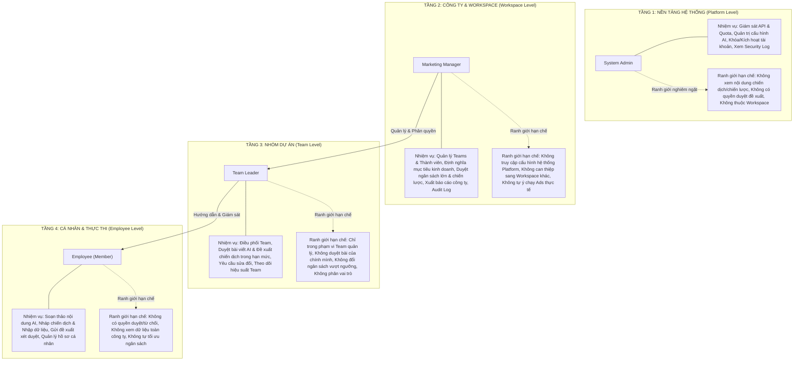
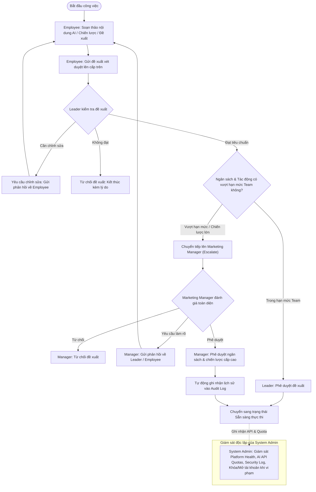

Dưới đây là sơ đồ **Flowchart phân cấp quyền hạn và luồng tương tác (RBAC & Workflow Governance)** dựa trên thông tin bảng phân quyền:

---

### 1. Sơ đồ phân tầng phạm vi & thẩm quyền (Hierarchical Scope & Boundaries)

---

### 2. Sơ đồ luồng nghiệp vụ & xét duyệt đề xuất (Approval & Escalation Workflow)

---

### 3. Tóm tắt ma trận quyền hạn (RBAC Matrix)

| Vai trò (Role)             | Phạm vi (Scope)                         | Quyền hạn chính (Responsibilities)                                                                                              | Giới hạn nghiêm ngặt (Restrictions)                                                                                                                               |
| :-------------------------- | :--------------------------------------- | :--------------------------------------------------------------------------------------------------------------------------------- | :-------------------------------------------------------------------------------------------------------------------------------------------------------------------- |
| **System Admin**      | **Platform** (Toàn nền tảng)    | Quản trị API, Quota AI, phân bổ hạ tầng, bảo mật, kích hoạt/khóa Workspace và tài khoản.                             | **Không** xem dữ liệu kinh doanh/chiến dịch; **Không** có quyền duyệt bài; **Không** thuộc Workspace nào.                              |
| **Marketing Manager** | **Workspace** (Công ty)           | Quản lý thành viên, đội nhóm; định hướng mục tiêu; duyệt đề xuất ngân sách lớn & chiến lược; xem Audit Log. | **Không** can thiệp hạ tầng hệ thống; **Không** truy cập Workspace khác; **Không** trực tiếp deploy tiêu ngân sách thật tự động. |
| **Leader**            | **Team** (Nhóm)                   | Điều phối nhóm; kiểm duyệt bài viết AI & chiến dịch trong thẩm quyền; phản hồi sửa đổi; báo cáo cho Manager.    | Chỉ trong phạm vi Team; **Không** tự duyệt bài của mình; **Không** duyệt vượt hạn mức ngân sách; **Không** mời/đổi vai trò.    |
| **Employee**          | **Own / Team** (Cá nhân & Nhóm) | Sử dụng AI tạo nội dung; nháp chiến lược, gửi đề xuất duyệt; theo dõi tiến độ công việc cá nhân.              | **Không** có quyền duyệt hay từ chối bài; **Không** xem dữ liệu toàn công ty; **Không** xuất báo cáo tổng.                         |
