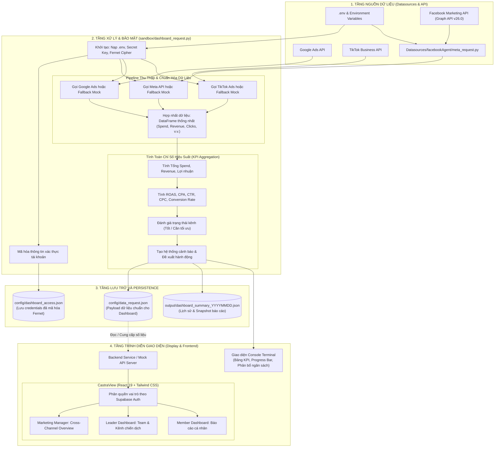

Dưới đây là sơ đồ luồng hoạt động (flowchart) và phân tích chi tiết quy trình xử lý, tổng hợp và hiển thị số liệu Dashboard bắt đầu từ script trung tâm `sandbox/dashboard_request.py`.

---

### 1. Flowchart tổng thể (Mermaid Diagram)

---

### 2. Chi tiết 4 giai đoạn hoạt động

#### Giai đoạn 1: Khởi tạo và bảo mật tài khoản

1. **Đọc cấu hình**: `dashboard_request.py` nạp các tham số xác thực (`FB_APP_ID`, `FB_ACCESS_TOKEN`, `CRYPTOGRAPHY_KEY`,...) từ file `.env`.
2. **Mã hóa thông tin xác thực**: Sử dụng thư viện `cryptography.fernet` để mã hóa Token và Account ID của các kênh (Meta, Google, TikTok), sau đó xuất ra file cấu hình bảo mật `config/dashboard_access.json`.

#### Giai đoạn 2: Thu thập và tổng hợp dữ liệu (ETL Pipeline)

1. **Gọi nguồn dữ liệu**:
   - **Meta Ads**: Tích hợp trực tiếp module `Datasources/facebookAgent/meta_request.py` để gọi Facebook Marketing API qua Facebook SDK.
   - **Google Ads & TikTok Ads**: Thu thập metrics chiến dịch hoặc sử dụng bộ giả lập thông số chuẩn hóa (fallback an toàn khi môi trường chưa cấu hình đủ API secret).
2. **Chuẩn hóa (Normalization)**: Dữ liệu từ các nền tảng khác nhau được chuyển về cùng một cấu trúc trường đồng nhất (`spend`, `revenue`, `impressions`, `clicks`, `conversions`).

#### Giai đoạn 3: Tính toán chỉ số & Xuất dữ liệu JSON

1. **Tính toán KPI**:
   - Tính tổng ngân sách (`total_spend`), tổng doanh thu (`total_revenue`), lợi nhuận ròng (`profit`).
   - Tính toán các tỷ lệ hiệu suất:
     $$
     \text{ROAS} = \frac{\text{Doanh thu}}{\text{Chi phí}}, \quad \text{CPA} = \frac{\text{Chi phí}}{\text{Chuyển đổi}}, \quad \text{CTR} = \frac{\text{Clicks}}{\text{Impressions}} \times 100\%
     $$
2. **Đánh giá sức khỏe chiến dịch**: Tự động gán nhãn trạng thái (`Hoạt động tốt`, `Cần tối ưu`) dựa trên ngưỡng ROAS và chi phí.
3. **Sinh cảnh báo thông minh**: Tự động phát hiện các bất thường (chi phí cao nhưng ROAS thấp, hoặc kênh hiệu quả cần tăng ngân sách).
4. **Lưu trữ**:
   - `config/data_request.json`: File dữ liệu đầu ra có cấu trúc chuẩn, phục vụ cho giao diện Dashboard.
   - `output/dashboard_summary_YYYYMMDD.json`: Snapshot lưu trữ theo ngày.

#### Giai đoạn 4: Hiển thị số liệu

1. **Trực quan hóa tại Terminal (CLI)**: Hiển thị ngay bảng thống kê KPI, biểu đồ thanh phân bổ ngân sách và các cảnh báo hành động trực quan.
2. **Chuyển tiếp lên Web Dashboard (`CastraView`)**:
   - File `config/data_request.json` cung cấp cấu trúc JSON hoàn chỉnh cho Frontend.
   - `CastraView` phân luồng dữ liệu theo vai trò người dùng (Marketing Manager, Leader, Member) để hiển thị lên các biểu đồ thống kê, bảng phân bổ ngân sách kênh và thẻ trạng thái hiệu suất.
