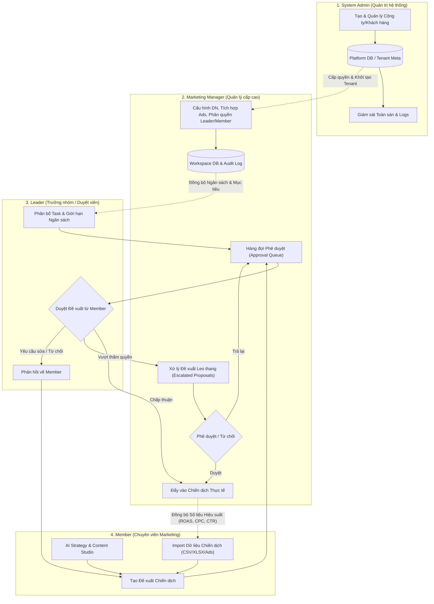
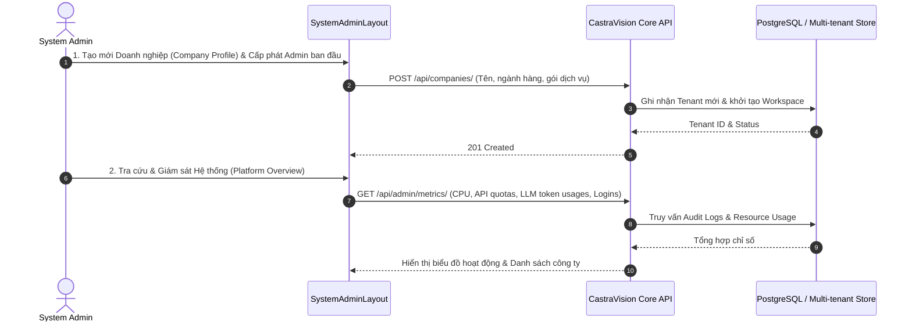
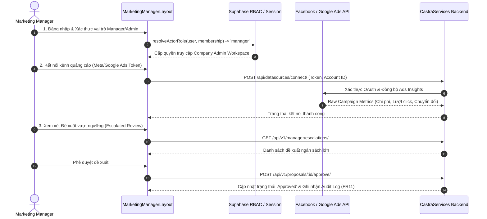
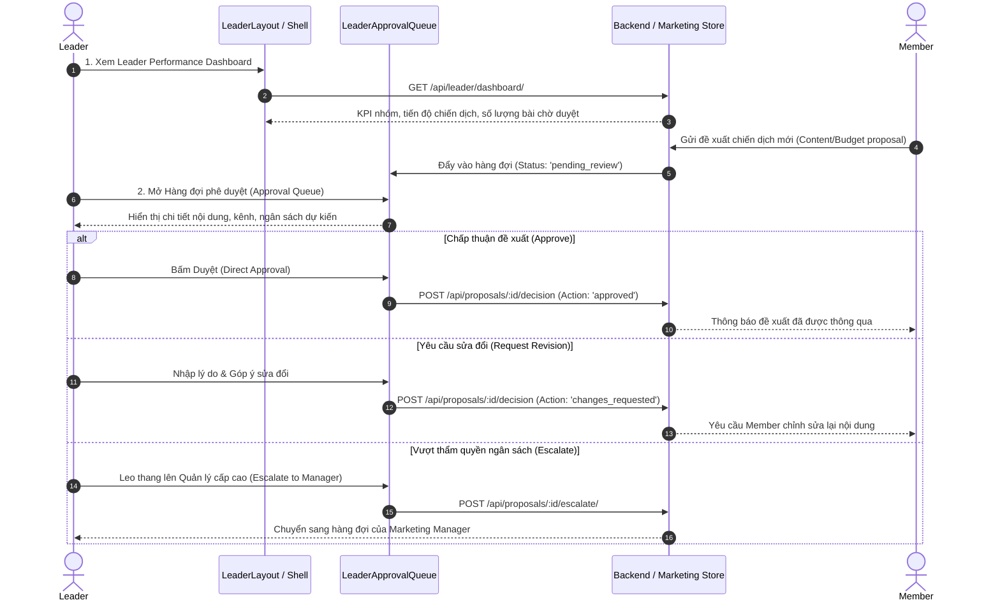
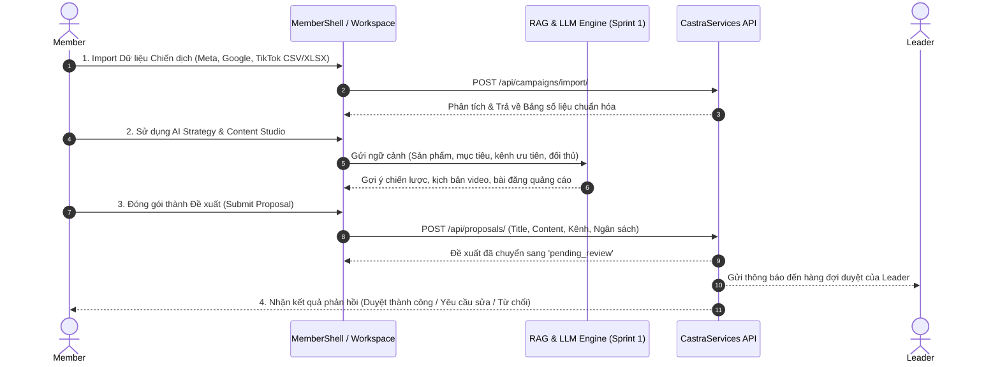

Dưới đây là sơ đồ phân tích luồng dữ liệu (**Data Flow Diagrams**) chi tiết cho từng vai trò (**Role**) trong hệ sinh thái CastraVision: **System Admin**, **Marketing Manager (Admin)**, **Leader**, và **Member (Employee)**, kết hợp cùng luồng dữ liệu tổng thể phân cấp giữa các vai trò.

---

### 1. Sơ đồ luồng dữ liệu tổng quan giữa 4 Roles (Hierarchical Data Flow)

Sơ đồ này mô tả cách dữ liệu dịch chuyển từ tầng cấu hình nền tảng, thiết lập doanh nghiệp, triển khai chiến dịch cho tới phê duyệt và báo cáo.

---

### 2. Luồng dữ liệu chi tiết cho từng Role

#### A. System Admin (Quản trị nền tảng toàn hệ thống)

* **Mục tiêu chính**: Quản trị multi-tenant (các doanh nghiệp/công ty), cấp phát tài nguyên, giám sát sức khỏe API, mô hình LLM/RAG và audit log toàn sàn.

---

#### B. Marketing Manager / Company Admin (Quản lý doanh nghiệp)

* **Mục tiêu chính**: Thiết lập hồ sơ doanh nghiệp, kết nối tài khoản quảng cáo (Meta Ads, Google Ads, TikTok), phân quyền nhân sự, và xử lý các đề xuất chiến dịch/ngân sách leo thang từ Leader.

---

#### C. Leader (Trưởng nhóm Marketing / Duyệt viên)

* **Mục tiêu chính**: Phân bổ mục tiêu cho Member, theo dõi Dashboard hiệu suất của nhóm, duyệt đề xuất Content/Strategy/Budget từ Member và chuyển cấp quản lý nếu vượt hạn mức.

---

#### D. Member (Chuyên viên Marketing thực thi)

* **Mục tiêu chính**: Tải lên dữ liệu hiệu suất (Import CSV/Excel), dùng công cụ AI Strategy & Content Studio để sinh nội dung/chiến lược, sau đó gửi đề xuất lên cho Leader phê duyệt.

---

### 3. Ma trận ma quyền & điểm truy cập dữ liệu (RBAC Data Access Matrix)

| Loại dữ liệu / Tính năng                     |     System Admin     |     Marketing Manager     |        Leader        |        Member        |
| :------------------------------------------------ | :------------------: | :-----------------------: | :-------------------: | :-------------------: |
| **Quản trị Multi-tenant & Công ty**      | Toàn quyền (CRUD) |   ❌ Không có quyền   | ❌ Không có quyền | ❌ Không có quyền |
| **Audit Log toàn hệ thống**              |      Đầy đủ      |    Chỉ trong công ty    | ❌ Không có quyền | ❌ Không có quyền |
| **Cấu hình API Keys (Meta/Google Ads)**   | ❌ Không can thiệp | Toàn quyền (Read/Write) | Chỉ xem trạng thái | ❌ Không có quyền |
| **Phê duyệt đề xuất ngân sách lớn** |          ❌          |      Duyệt cấp cao      | Leo thang (Escalate) |          ❌          |
| **Phê duyệt đề xuất Content/Strategy** |          ❌          |    Can thiệp khi cần    |  Duyệt trực tiếp  |          ❌          |
| **Tạo đề xuất & sinh nội dung AI**     |          ❌          |         Tạo mẫu         |  Tạo & chỉnh sửa  |  Tạo & đệ trình  |
| **Nhập dữ liệu chiến dịch (Import)**   |          ❌          |        Đầy đủ        |      Đầy đủ      | Nhập theo nhiệm vụ |
