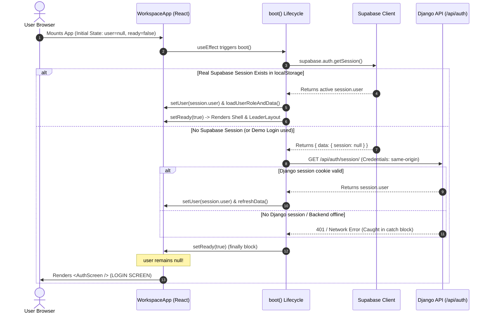

# CastraVision: Leader Strategy Studio & Refresh-to-Login Investigation Report

**Document Version:** 1.0.0  
**Inspection Date:** 2026-11-11  
**Status:** Investigation Only (Read-Only Complete – Ready for Review)

---

## Executive Summary

This investigation analyzes two specific issues identified in the Leader workspace of CastraVision:
1. **Strategy Studio is missing from the Leader interface:**  
   The navigation item `{ key: 'strategy', label: 'Strategy Studio' }` is defined in `roleNavConfig.js`, but there is **no dedicated Leader Strategy Studio screen component** in `src/leader/screens/` matching the approved Google Stitch design (`leader_workspace_strategy_studio.html`). Instead, the route currently falls back to a legacy Sprint 1 generic input form (`StrategyScreen` in `src/App.jsx`), leaving the actual Strategy Studio dashboard unimplemented for the Leader role.
2. **Refreshing a Leader page redirects the user to Login:**  
   The application uses in-memory React state (`useState`) without persisting the active session/role to browser storage when using Quick RBAC Demo Access or client state. On browser refresh (`F5`), React state unmounts, `user` resets to `null`, and `App.jsx` evaluates `if (!user) return <AuthScreen />` before or because no persistent session exists in `localStorage`, dropping the user immediately to the Login screen. Furthermore, client-side routing is state-based rather than URL-based, resetting navigation to `'overview'` on every reload.

---

## 1. Strategy Studio Status and Existing Component / Route

### 1.1 Existing Assets in the Codebase & Design Specifications
* **Approved Design Reference:**  
  [`docs/Leader FORM/stitch_castravision_core_workflows_ui/leader_workspace_strategy_studio/leader_workspace_strategy_studio.html`](file:///d:/essclip/CAPSTONE2APP/CastraVision/docs/Leader%20FORM/stitch_castravision_core_workflows_ui/leader_workspace_strategy_studio/leader_workspace_strategy_studio.html)  
  * **Title:** Leader Workspace – Strategy Studio (`Macro Strategy Overview`).
  * **Header Breadcrumb:** `Leader Workspace > Strategy Studio > Macro Strategy Overview`.
  * **Key Modules:**
    1. **Top KPI Strip:** 4 stat cards (*Aggregate Strategy Confidence 94.2%*, *Active Algorithmic Directives 12 Rules*, *Monthly Pacing Efficiency +18.4%*, *Projected Cross-Channel ROAS 4.85x*).
    2. **Active Strategy Engine Banner:** *Neural Allocation Matrix v4.2* with *Inspect Model* action.
    3. **Strategy Comparison Matrix (Monte Carlo Chart):** *Projected ROAS vs. Risk Exposure (Active Strategies)* with inline SVG scatter plot and risk-to-return simulation curves.
    4. **Tactical Channel Allocation Breakdown:** Meta Ads, Google Ads, and TikTok Ads target CPAs, volume caps, and algorithm confidence metrics.
    5. **Directives & Feedback Log:** Model execution log and status telemetry.

* **Existing Leader Screen Files:**  
  Inspecting [`CastraView/src/leader/screens/`](file:///d:/essclip/CAPSTONE2APP/CastraVision/CastraView/src/leader/screens):
  * `LeaderApprovalQueue.jsx`
  * `LeaderBudgetReview.jsx`
  * `LeaderCampaigns.jsx`
  * `LeaderContentReview.jsx`
  * `LeaderDashboard.jsx`
  * `LeaderPerformance.jsx`
  * ⚠️ **MISSING:** There is **NO** `LeaderStrategyStudio.jsx` in `src/leader/screens/`.

### 1.2 Current Route & Component Mapping
* In [`CastraView/src/App.jsx`](file:///d:/essclip/CAPSTONE2APP/CastraVision/CastraView/src/App.jsx#L1414-L1422):
  ```jsx
  {page === 'strategy' && (
    <StrategyScreen
      profile={profile}
      latestRows={latestRows}
      result={strategy}
      setResult={setStrategy}
      notify={setToast}
    />
  )}
  ```
* In [`CastraView/src/App.jsx`](file:///d:/essclip/CAPSTONE2APP/CastraVision/CastraView/src/App.jsx#L599-L655):
  `StrategyScreen` is an inline legacy Sprint 1 form (*"Tạo chiến lược"* / *"Strategy Engine"* with basic input fields for target audience, campaign goal, budget, and a generate button calling Django `/api/strategies/generate/`). It has completely different layout, components, and data structures from the Stitch Leader Strategy Studio specification.

---

## 2. Exact Reason Strategy Studio is Missing from Leader Interface

1. **Missing Screen Implementation:** While the navigation item `{ key: 'strategy', label: 'Strategy Studio', icon: IconGlobe }` exists in [`roleNavConfig.js`](file:///d:/essclip/CAPSTONE2APP/CastraVision/CastraView/src/navigation/roleNavConfig.js#L50), the Leader workspace was never wired to a dedicated `LeaderStrategyStudio.jsx` component.
2. **Subpage Key Resolution:** In [`LeaderSidebar.jsx`](file:///d:/essclip/CAPSTONE2APP/CastraVision/CastraView/src/leader/LeaderSidebar.jsx#L27-L42), `resolveActiveKey` maps subpages (e.g., `content-reviews` ➔ `approvals`, `assigned-campaigns` ➔ `campaigns`). Key `'strategy'` passes through, but because no dedicated screen existed, users either land on the legacy generic `StrategyScreen` or perceive the feature as entirely absent from the Leader workflow.
3. **No Route URL:** `CastraView` does not use `react-router-dom` for screen routing. Switching to Strategy Studio does not update the browser URL (it remains `http://localhost:5173/`).

---

## 3. Authentication Lifecycle Findings

Tracing the complete authentication and session lifecycle in [`CastraView/src/App.jsx`](file:///d:/essclip/CAPSTONE2APP/CastraVision/CastraView/src/App.jsx):



### Detailed Observations:
1. **Application Startup & Initialization:**
   [`App.jsx:968-985`](file:///d:/essclip/CAPSTONE2APP/CastraVision/CastraView/src/App.jsx#L968-L985) initializes `user = null`, `ready = false`, and `page = 'overview'`.
2. **Session Persistence via Supabase:**
   [`src/lib/supabase.js`](file:///d:/essclip/CAPSTONE2APP/CastraVision/CastraView/src/lib/supabase.js#L21-L27) configures `persistSession: true`. Real logins via `supabase.auth.signInWithPassword` write to `localStorage` key `sb-<project-ref>-auth-token`.
3. **Demo Login Bypass:**
   [`App.jsx:1163-1222`](file:///d:/essclip/CAPSTONE2APP/CastraVision/CastraView/src/App.jsx#L1163-L1222) (`handleDemoLogin`):
   When clicking the quick RBAC access button for "Leader", the user state is set purely in React state (`setUser(demo)`). It does **NOT** write to `localStorage` or create a session in Supabase or cookie storage.
4. **Auth Context Independence:**
   Although [`src/auth/AuthProvider.jsx`](file:///d:/essclip/CAPSTONE2APP/CastraVision/CastraView/src/auth/AuthProvider.jsx) and [`src/auth/AuthContext.js`](file:///d:/essclip/CAPSTONE2APP/CastraVision/CastraView/src/auth/AuthContext.js) exist in the codebase, they are **not imported or used** in `App.jsx` or `main.jsx`. `App.jsx` manages its own monolithic auth flow.

---

## 4. Exact Refresh-to-Login Root Cause

The root cause of the refresh-to-login bug is confirmed:

1. **Ephemeral In-Memory State for Demo Logins:**  
   In standard development/testing workflows, clicking the "Leader" demo button sets in-memory React state `user = { role: 'leader', ... }`. On browser refresh (`F5`), React state is wiped. Because `handleDemoLogin` never writes to `localStorage` or `sessionStorage`, `boot()` finds no Supabase session and no Django cookie, leaving `user = null`.
2. **Synchronous Auth Guard Fallthrough:**  
   In [`App.jsx:1269-1280`](file:///d:/essclip/CAPSTONE2APP/CastraVision/CastraView/src/App.jsx#L1269-L1280):
   ```jsx
   if (!ready) {
     return <div className="loading-screen">...</div>
   }
   if (!user) {
     return <AuthScreen ... />
   }
   ```
   When `boot()` completes without recovering a session, `ready` becomes `true` and `user` is `null`. The component immediately renders `AuthScreen` (Login screen).
3. **State-Based Navigation Loss:**  
   Because all screens are managed by `const [page, setPage] = useState('overview')` without URL sync or route parameters, even if a session were recovered, any refresh resets `page` back to `'overview'`, discarding whichever subscreen (such as Approvals, Campaigns, or Strategy) the Leader was viewing.

---

## 5. Relevant File Paths and Line References

| File Path | Line Range | Role in Issue |
| :--- | :--- | :--- |
| [`CastraView/src/App.jsx`](file:///d:/essclip/CAPSTONE2APP/CastraVision/CastraView/src/App.jsx) | `L1061-L1091` | `boot()` lifecycle: restores session, but sets `ready=true` without fallback persistence. |
| [`CastraView/src/App.jsx`](file:///d:/essclip/CAPSTONE2APP/CastraVision/CastraView/src/App.jsx) | `L1163-L1222` | `handleDemoLogin()`: sets in-memory state only, causing session loss on F5. |
| [`CastraView/src/App.jsx`](file:///d:/essclip/CAPSTONE2APP/CastraVision/CastraView/src/App.jsx) | `L1269-L1280` | Auth guard: renders `AuthScreen` immediately when `!user`. |
| [`CastraView/src/App.jsx`](file:///d:/essclip/CAPSTONE2APP/CastraVision/CastraView/src/App.jsx) | `L1414-L1422` | Leader route: renders legacy `StrategyScreen` instead of dedicated `LeaderStrategyStudio`. |
| [`CastraView/src/navigation/roleNavConfig.js`](file:///d:/essclip/CAPSTONE2APP/CastraVision/CastraView/src/navigation/roleNavConfig.js) | `L45-L55` | `LEADER_NAV_ITEMS`: defines item `{ key: 'strategy', label: 'Strategy Studio' }`. |
| [`CastraView/src/leader/LeaderSidebar.jsx`](file:///d:/essclip/CAPSTONE2APP/CastraVision/CastraView/src/leader/LeaderSidebar.jsx) | `L27-L42` | `resolveActiveKey()`: maps subpages to sidebar keys. |
| [`CastraView/src/leader/screens/`](file:///d:/essclip/CAPSTONE2APP/CastraVision/CastraView/src/leader/screens) | N/A | Missing component `LeaderStrategyStudio.jsx`. |
| [`CastraView/src/lib/supabase.js`](file:///d:/essclip/CAPSTONE2APP/CastraVision/CastraView/src/lib/supabase.js) | `L19-L27` | Supabase client setup with `persistSession: true`. |
| [`docs/Leader FORM/.../leader_workspace_strategy_studio.html`](file:///d:/essclip/CAPSTONE2APP/CastraVision/docs/Leader%20FORM/stitch_castravision_core_workflows_ui/leader_workspace_strategy_studio/leader_workspace_strategy_studio.html) | `L1-L414` | Canonical Stitch design specification for Leader Strategy Studio. |

---

## 6. Proposed Minimal Fix for Each Issue

### Fix 1: Implement Dedicated Leader Strategy Studio
1. **Create Component:** Create `CastraView/src/leader/screens/LeaderStrategyStudio.jsx` translating the approved Google Stitch design (`leader_workspace_strategy_studio.html`) into React:
   - Macro Strategy Overview KPI strip.
   - Monte Carlo Projected ROAS vs. Risk Exposure interactive/SVG scatter chart.
   - Tactical Channel Allocation breakdown (Meta Ads, Google Ads, TikTok Ads).
   - Real-time engine process logs and algorithmic directives.
2. **Wire in `LeaderLayout` / `App.jsx`:**
   - In `CastraView/src/App.jsx`, import `LeaderStrategyStudio` and replace `StrategyScreen` in the Leader block (`actorRole === 'leader'`) at line 1414:
     ```jsx
     {page === 'strategy' && (
       <LeaderStrategyStudio setPage={setPage} notify={setToast} />
     )}
     ```
3. **Verify Navigation Sync:** Ensure `LeaderSidebar.jsx` and `roleNavConfig.js` maintain `{ key: 'strategy', label: 'Strategy Studio' }` with correct active state highlighting.

### Fix 2: Session & Navigation Persistence on Refresh
1. **Persist Active Demo / Session State in `localStorage`:**
   - In `handleDemoLogin(roleKey)`:
     ```javascript
     localStorage.setItem('castravision_demo_role', roleKey)
     ```
   - In `logout()`:
     ```javascript
     localStorage.removeItem('castravision_demo_role')
     localStorage.removeItem('castravision_current_page')
     ```
   - In `boot()`:
     ```javascript
     const savedDemoRole = localStorage.getItem('castravision_demo_role')
     if (savedDemoRole && demos[savedDemoRole]) {
       handleDemoLogin(savedDemoRole)
       const savedPage = localStorage.getItem('castravision_current_page')
       if (savedPage) setPage(savedPage)
       setReady(true)
       return
     }
     ```
2. **Persist Current Page:**
   - Wrap `setPage` or add an effect that synchronizes `page` to `localStorage.setItem('castravision_current_page', page)` (and/or URL search param `?page=strategy`), ensuring that pressing `F5` keeps the user on their active subscreen instead of reverting to `'overview'`.

---

## 7. Risks and Regression Tests Required

### 7.1 Regression & Security Checks
* **Role Isolation & Permissions:**  
  Persisting demo session keys must be scoped to client-side demo simulation (`castravision_demo_role`). Production backend API calls still validate real Supabase JWTs / Django session CSRF cookies. Client-side state cannot grant elevated backend permissions.
* **Non-Leader Roles:**  
  System Admin, Marketing Manager, and Employee (Member) flows must remain untouched and verified against their respective layouts.

### 7.2 Required Test Plan Prior to Merge
1. **Leader Strategy Studio:**
   - Navigate to Leader workspace ➔ Click "Strategy Studio" in Sidebar.
   - Confirm the Stitch design renders (Monte Carlo chart, KPI summary, tactical allocation).
   - Confirm Breadcrumbs read: `Leader Workspace > Strategy Studio`.
2. **Browser Refresh (`F5`):**
   - Log in as Leader ➔ Navigate to `Strategy Studio` ➔ Press `F5` / Refresh.
   - Verify page stays on `Strategy Studio` as Leader without redirecting to Login screen.
   - Repeat for `Approvals` queue, `Campaigns`, and `Performance & Insights`.
   - Repeat refresh test for Member, Marketing Manager, and System Admin.
3. **Real Logout:**
   - Click "Sign Out" ➔ Verify `localStorage` demo and session keys are wiped, cleanly returning to `AuthScreen`.
4. **Code Quality:**
   - Run `npm run lint` (`oxlint`) ➔ 0 errors.
   - Run `npm run build` (`vite build`) ➔ 0 errors.

---

## Conclusion

Step 2 investigation is complete. The root causes for both issues are fully identified, verified against the codebase and running browser, and documented with line-level evidence. We await your approval before proceeding with implementation.
