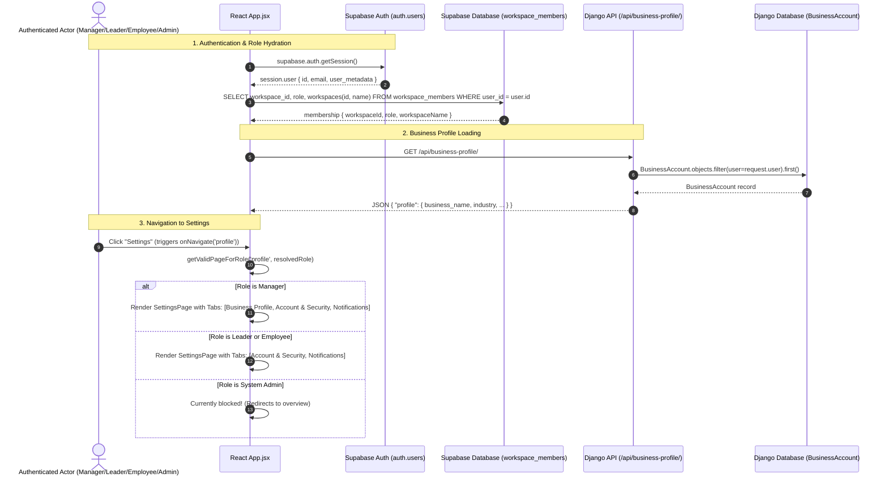
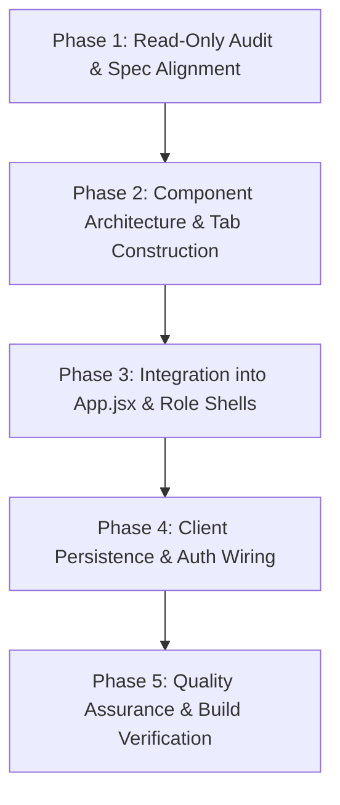

# CastraVision – Settings Page Implementation
# Phase 1: Design Analysis and Existing Code Audit Report

**Document:** `docs/settings_implementation_audit.md`  
**Date:** 2026-11-14  
**Audit Scope:** Frontend Architecture, Role Navigation, Stitch Design Synchronization, API & Data Flow Integrity  
**Target Actors:** Marketing Manager, Leader, Employee (Member), System Admin  
**Status:** Audit Completed – Awaiting Approval  

---

## 1. Executive Summary & Existing Settings Architecture

This audit investigates the current state of Settings and Profile features across all four CastraVision user roles prior to implementing a unified, role-aware Settings module.

### 1.1 Current Architecture Overview
Currently, the application has an architectural disconnect between user expectations and page delivery:
1. **Misaligned Screen Delivery:** In [App.jsx](file:///d:/essclip/CAPSTONE2APP/CastraVision/CastraView/src/App.jsx), navigating to the `profile` route (triggered by sidebar items labeled "Settings", "Account Settings", or header user dropdowns) renders an inline legacy component named `ProfileScreen` ([App.jsx:280-425](file:///d:/essclip/CAPSTONE2APP/CastraVision/CastraView/src/App.jsx#L280-L425)).
2. **Missing Personal & Notification Capabilities:** The rendered `ProfileScreen` is exclusively a **Company Onboarding / Business Profile wizard** (Company Name, Industry, Business Size, Target Audience, Goals, Monthly Budget, Channels). It contains **zero personal account management** (Full Name, Job Title, Avatar), **zero security/password controls**, and **zero notification preference toggles**.
3. **Role Bleed & Authorization Leak:** Both Leader and Employee/Member render the exact same editable `ProfileScreen` as Marketing Manager, complete with a functional `saveProfile` callback executing `PUT /api/business-profile/`. This directly violates the RBAC specification ([docs/superpowers/specs/2026-10-06-supabase-auth-rls-design.md](file:///d:/essclip/CAPSTONE2APP/CastraVision/docs/superpowers/specs/2026-10-06-supabase-auth-rls-design.md)), which restricts business profile editing strictly to the Marketing Manager (Company Admin).
4. **System Admin Exclusion:** The System Admin operating in [SystemAdminLayout.jsx](file:///d:/essclip/CAPSTONE2APP/CastraVision/CastraView/src/system-admin/SystemAdminLayout.jsx) does not have access to any personal settings or profile screen. The `profile` route is hard-blocked by `ROLE_ALLOWED_PAGES.system_admin` in [App.jsx:1051-1054](file:///d:/essclip/CAPSTONE2APP/CastraVision/CastraView/src/App.jsx#L1051-L1054).

---

## 2. Active and Unused Components

| Component / File | Location | Current State | Audit Findings & Recommendations |
| :--- | :--- | :---: | :--- |
| **`ProfileScreen`** (Inline) | [CastraView/src/App.jsx:280-425](file:///d:/essclip/CAPSTONE2APP/CastraVision/CastraView/src/App.jsx#L280-L425) | **Active** | Renders legacy 2-step onboarding wizard using deprecated CSS classes (`shell`, `stepper`, `card profile-card`, `form-grid`). Should be replaced by the shared `SettingsPage`. |
| **`ProfilePage.jsx`** | [CastraView/src/pages/ProfilePage.jsx](file:///d:/essclip/CAPSTONE2APP/CastraVision/CastraView/src/pages/ProfilePage.jsx) | **Orphaned (Unused)** | Implemented using modern Tailwind v4 + shadcn/ui tokens. Has a **100% identical data contract** with `ProfileScreen`. It is never imported anywhere in the codebase. Should be refactored into the `BusinessProfileTab` component of the shared `SettingsPage`. |
| **`SettingsPage.jsx`** | `CastraView/src/pages/SettingsPage.jsx` | **Non-existent** | Does not exist yet. Needs to be created as the master, role-aware container for all 4 actors. |
| **`MarketingManagerSidebar.jsx`** | [CastraView/src/company-admin/MarketingManagerSidebar.jsx](file:///d:/essclip/CAPSTONE2APP/CastraVision/CastraView/src/company-admin/MarketingManagerSidebar.jsx) | **Active** | Navigation item 11 (`Settings`) triggers `onNavigate('profile')`. Conforms to Stitch layout. |
| **`MarketingManagerHeader.jsx`** | [CastraView/src/company-admin/MarketingManagerHeader.jsx](file:///d:/essclip/CAPSTONE2APP/CastraVision/CastraView/src/company-admin/MarketingManagerHeader.jsx) | **Active** | User dropdown item "Account Profile" triggers `onNavigate('profile')`. |
| **`LeaderSidebar.jsx`** | [CastraView/src/leader/LeaderSidebar.jsx](file:///d:/essclip/CAPSTONE2APP/CastraVision/CastraView/src/leader/LeaderSidebar.jsx) | **Active** | Navigation item 11 (`Settings` / `Account Settings`) triggers `onNavigate('profile')`. |
| **`LeaderHeader.jsx`** | [CastraView/src/leader/LeaderHeader.jsx](file:///d:/essclip/CAPSTONE2APP/CastraVision/CastraView/src/leader/LeaderHeader.jsx) | **Active** | User dropdown triggers `onNavigate('profile')`. |
| **`MemberSidebar.jsx`** | [CastraView/src/member/MemberSidebar.jsx](file:///d:/essclip/CAPSTONE2APP/CastraVision/CastraView/src/member/MemberSidebar.jsx) | **Active** | Navigation item "My Profile" triggers `onNavigate('profile')`. |
| **`MemberHeader.jsx`** | [CastraView/src/member/MemberHeader.jsx](file:///d:/essclip/CAPSTONE2APP/CastraVision/CastraView/src/member/MemberHeader.jsx) | **Active** | User dropdown triggers `onNavigate('profile')`. |
| **`SystemAdminSidebar.jsx`** | [CastraView/src/system-admin/SystemAdminSidebar.jsx](file:///d:/essclip/CAPSTONE2APP/CastraVision/CastraView/src/system-admin/SystemAdminSidebar.jsx) | **Active** | Contains only `Dashboard` and `Company Management`. No settings item. |
| **`SystemAdminHeader.jsx`** | [CastraView/src/system-admin/SystemAdminHeader.jsx](file:///d:/essclip/CAPSTONE2APP/CastraVision/CastraView/src/system-admin/SystemAdminHeader.jsx) | **Active** | User dropdown displays email and "Logout", but lacks a "Settings" link. |

---

## 3. Current Routing and Role Permissions

### 3.1 Routing Enforcer: `getValidPageForRole`
In [App.jsx:1031-1061](file:///d:/essclip/CAPSTONE2APP/CastraVision/CastraView/src/App.jsx#L1031-L1061), page routing is controlled by whitelist sets:

```javascript
const ROLE_ALLOWED_PAGES = {
  leader: new Set([
    'overview', 'approvals', 'content-reviews', 'content-review-detail',
    'budget-review-detail', 'budget', 'campaigns', 'assigned-campaigns',
    'my-proposals', 'submissions', 'strategy', 'content', 'import',
    'performance', 'reports', 'insights', 'team-tasks', 'profile', 'notifications',
  ]),
  member: new Set([
    'overview', 'tasks', 'emp-tasks', 'content', 'assigned-campaigns',
    'submissions', 'reports', 'strategy', 'notifications', 'profile',
    'budget', 'insights', 'import',
  ]),
  manager: new Set([
    'overview', 'members', 'roles', 'approvals', 'audit', 'budget',
    'budget-review', 'reports', 'insights', 'import', 'content', 'profile',
  ]),
  system_admin: new Set([
    'overview', 'sa-dashboard', 'sa-company-mgmt', 'sa-company-overview', 'sa-create-company',
  ]),
}
```

### 3.2 Role Permission Discrepancies
1. **System Admin Route Blocking:** `system_admin` whitelist does not contain `'profile'`. Any navigation attempt to `profile` evaluates as invalid and redirects to `'overview'`. To allow System Administrators to manage their personal credentials, `'profile'` (or a dedicated `'sa-settings'`) must be added to `ROLE_ALLOWED_PAGES.system_admin`.
2. **Leader & Member Unauthorized Access to Business Profile:**
   - [App.jsx:1593-1600](file:///d:/essclip/CAPSTONE2APP/CastraVision/CastraView/src/App.jsx#L1593-L1600) (Leader) and [App.jsx:1730-1737](file:///d:/essclip/CAPSTONE2APP/CastraVision/CastraView/src/App.jsx#L1730-L1737) (Member) pass `saveProfile={saveProfile}` to `ProfileScreen`.
   - If a Leader or Member saves changes, it dispatches `PUT /api/business-profile/`.
   - Under the approved specifications, Leaders and Employees **must not be able to edit Business Profile**. Their Settings page must consist strictly of **Account & Security** and **Notification Preferences**.

---

## 4. Comparison of All Four Stitch Designs

The approved Stitch references are located in `docs/UI/Setting Pages/Setting Page/`:
- `castravision_enterprise/DESIGN.md` (Design System Tokens & Archetype)
- `leader_settings/` (`leader_settings.html`, `leader_settings.png`)
- `employee_settings/` (`employee_settings.html`, `employee_settings.png`)
- `system_admin_settings/` (`system_admin_settings.html`, `system_admin_settings.png`)

### 4.1 Comparative Feature Matrix

| Design Attribute | Marketing Manager | Leader | Employee (Member) | System Admin |
| :--- | :--- | :--- | :--- | :--- |
| **Approved Reference** | `castravision_enterprise/DESIGN.md` & template script | `leader_settings.html` / `.png` | `employee_settings.html` / `.png` | `system_admin_settings.html` / `.png` |
| **Visible Tabs** | **3 Tabs:**<br>1. Workspace & Business Profile<br>2. Account & Security<br>3. Notification Preferences | **2 Tabs:**<br>1. Account & Security<br>2. Notification Preferences | **2 Tabs:**<br>1. Account & Security<br>2. Notification Preferences | **2 Tabs:**<br>1. Account & Security<br>2. Notification Preferences |
| **Tab 1: Business Profile** | **Editable Form:** Company Name, Industry, Size, Target Audience, Description, Products/Services, Goal, Monthly Budget, Channel Tags. | **None** (Omitted from UI) | **None** (Omitted from UI) | **None** (Omitted from UI) |
| **Tab 2 (or 1): Personal Info** | Full Name, Job Title, Readonly Email with lock, Readonly Role with lock. | Full Name (`David Kross`), Job Title (`Growth Marketing Lead`), Email (readonly), Role (readonly). | Full Name (`Elena Rostova`), Job Title (`Senior Content Specialist`), Email (readonly), Role (readonly). | Full Name (`Liam Tanaka`), Job Title (`Root System Administrator`), Email (readonly), Role (readonly). |
| **Avatar Representation** | Two-letter initials badge (`SJ` / `AC`), solid background, high contrast, zero file upload. | Two-letter initials badge (`DK`), solid background, zero file upload. | Two-letter initials badge (`ER`), solid background, zero file upload. | Two-letter initials badge (`LT`), solid background, zero file upload. |
| **Change Password Card** | Current Password, New Password, Confirm Password with eye visibility toggles. | Current Password, New Password, Confirm Password with eye visibility toggles. | Current Password, New Password, Confirm Password with eye visibility toggles. | Current Password, New Password, Confirm Password with eye visibility toggles. |
| **Password Rules Indicator** | 3 Rules: >=8 chars, uppercase letter, number/special symbol. | 3 Rules: >=8 chars, uppercase letter, number/special symbol. | 4 Rules: >=8 chars, uppercase (A-Z), number (0-9), special symbol. | 4 Rules: >=8 chars, uppercase, number, special symbol. |
| **Notification Preferences** | 4 Categories: Campaign, Approvals, Budget, General (total 9 toggle switches). | 4 Categories: Campaign, Approvals, Budget, General (total 9 toggle switches). | 4 Categories: Campaign, Approvals, Budget, General (total 9 toggle switches). | 4 Categories: Campaign, Approvals, Budget, General (total 9 toggle switches). |
| **Notification Actions** | Reset to Defaults (destructive red), Save Preferences (`#28a745` green). | Reset to Defaults (destructive red), Save Preferences (`#28a745` green). | Reset to Defaults (destructive red), Save Preferences (`#28a745` green). | Reset to Defaults (destructive red), Save Preferences (`#28a745` green). |

### 4.2 Visual Styling Rules Across All Four Designs
- **Surfaces:** Dark mode `#0f131d` root canvas; `#171b26` header bar (`h-16`) and sidebar (`w-[260px]`); `#1c1f2a` / `#1e293b` container cards; `#0a0e18` / `#262a35` inset input canvases; `#464554` borders.
- **Typography:** `Plus Jakarta Sans` for titles and card headlines; `Inter` for form labels, descriptions, and buttons; `JetBrains Mono` for badges, tags, and system IDs.
- **Controls & Buttons:**
  - Form submit / Save Changes: `#28a745` solid green (`hover:bg-[#218838]`), white text, check/save icon.
  - Password update: `#8083ff` primary container indigo (`hover:bg-primary`), white text.
  - Secondary / Cancel: Transparent or `#262a35`, border `#464554`, text `#dfe2f1`.
  - Destructive / Reset: `#93000a`/20 or `#dc3545`, text `#ffb4ab`.
  - Input fields: 44px height (`h-11`), 8px radius (`rounded-lg`), border `#464554`, focus ring `#8083ff`.
  - Toggle switches: 44x24px (`w-11 h-6`), rounded-full, active `#8083ff`, thumb 20px white.

---

## 5. Existing API and Data Flow

### 5.1 End-to-End Sequence Diagram



### 5.2 User Identity & Workspace Resolution
- **User Identity:** Resolved via `supabase.auth.getSession()` ([App.jsx:1217](file:///d:/essclip/CAPSTONE2APP/CastraVision/CastraView/src/App.jsx#L1217)) or fallback `api('auth/session/')`. `user.email` and `user.id` serve as primary identifiers.
- **Workspace Membership:** Loaded via query to `public.workspace_members` ([App.jsx:1142-1154](file:///d:/essclip/CAPSTONE2APP/CastraVision/CastraView/src/App.jsx#L1142-L1154)). Returns `workspace_id`, `role`, and `workspaces.name`.
- **Workspace ID Passing:** Kept in top-level React state `membership` and passed as props (`membership={membership}`) to child pages.

---

## 6. Backend Authorization Risks

1. **Missing Backend RBAC Check in Django:**
   - In [CastraServices/account_api.py:122-192](file:///d:/essclip/CAPSTONE2APP/CastraVision/CastraServices/account_api.py#L122-L192), the `profile` view checks `if not request.user.is_authenticated: return 401`.
   - **Zero permission checks are performed.** The endpoint does not verify whether `request.user` possesses an `admin` or `manager` role.
   - Any authenticated Django user sending a `PUT` request can mutate business profile records.
2. **User-Scoped vs. Workspace-Scoped Data Split:**
   - Django's `BusinessAccount` model is keyed by `user=request.user` (`OneToOneField` or `ForeignKey`), **not by `workspace_id`**.
   - If a Manager and a Leader authenticate with separate Django user accounts within the same company workspace, they query and mutate two completely separate `BusinessAccount` rows!
   - In Supabase, the schema defines `public.business_profiles` keyed by `workspace_id` ([supabase/migrations/20261004083830_init_schema.sql:50-58](file:///d:/essclip/CAPSTONE2APP/CastraVision/supabase/migrations/20261004083830_init_schema.sql#L50-L58)), but Django does not interact with this table.
3. **Workspace Name Drift:**
   - When a Marketing Manager updates `business_name` via `PUT /api/business-profile/`, Django updates `BusinessAccount.business_name`.
   - However, Supabase's `public.workspaces.name` remains untouched, causing tenant display names to drift between the frontend shell and the backend profile.

---

## 7. Unsupported or Mock Functionality

To ensure zero false assumptions during implementation, here is the exact operational status of each capability:

| Capability | Backend Support | Supabase Support | Frontend Status | Implementation Recommendation |
| :--- | :---: | :---: | :---: | :--- |
| **Business Profile Update** | **Implemented** (`PUT /api/business-profile/`) | Schema exists (`business_profiles`), but Django writes to `BusinessAccount` | **Implemented** (Wizard) | Wire into `BusinessProfileTab`, restricted strictly to `actorRole === 'manager'`. |
| **Personal Info: Full Name** | None in Django | Supported via `supabase.auth.updateUser({ data: { full_name } })` & `public.profiles` | **Mock UI Only** | Update via Supabase Auth metadata and sync to local state + toast feedback. |
| **Personal Info: Job Title** | None in Django | No column in `public.profiles`. Storable in `user_metadata` | **Mock UI Only** | Store in `supabase.auth.updateUser({ data: { job_title } })` or browser session state. |
| **Personal Info: Email** | Readonly | Readonly | **Readonly** | Display with lock icon and disabled styling across all roles. |
| **Personal Info: Role** | Readonly | Readonly | **Readonly** | Display with lock icon and role badge across all roles. |
| **Avatar File Upload** | **Not Implemented** | Bucket not configured | **Not in Stitch Design** | Stitch designs use 2-letter uppercase initials badges (e.g., `DK`, `ER`, `LT`, `AC`). Do not introduce file upload inputs. |
| **Change Password** | No Django endpoint | Supported via `supabase.auth.updateUser({ password: newPassword })` | **Mock UI Only** | Wire to `supabase.auth.updateUser` when session is active; fallback to toast feedback in demo mode. |
| **Notification Preferences** | **Not Implemented** (No table) | Table `public.notifications` is for messages, not user preference toggles | **Mock UI Only** | Persist client-side using `localStorage` keyed by user ID (`castravision_notif_prefs:<userId>`), with "Reset to Defaults". |

---

## 8. Recommended Shared Component Architecture

To eliminate code duplication while strictly enforcing role visibility, create a unified `SettingsPage` with modular tab subcomponents:

```
CastraView/src/
├── pages/
│   └── SettingsPage.jsx                  # Master role-aware container
└── components/
    └── settings/
        ├── BusinessProfileTab.jsx        # Adapted from ProfilePage.jsx (Manager-only)
        ├── AccountSecurityTab.jsx        # Personal Information + Password Cards
        ├── NotificationPreferencesTab.jsx# 4 Alert Categories with switches
        └── SettingsHeader.jsx            # Title, subtitle, and dynamic tab pills
```

### 8.1 Tab Access Control by Role

```javascript
// Tab configuration matrix
const ROLE_TABS = {
  manager: [
    { id: 'business', label: 'Hồ sơ doanh nghiệp', icon: 'Building2' },
    { id: 'security', label: 'Tài khoản & Bảo mật', icon: 'ShieldCheck' },
    { id: 'notifications', label: 'Tùy chọn thông báo', icon: 'Bell' },
  ],
  leader: [
    { id: 'security', label: 'Tài khoản & Bảo mật', icon: 'ShieldCheck' },
    { id: 'notifications', label: 'Tùy chọn thông báo', icon: 'Bell' },
  ],
  member: [
    { id: 'security', label: 'Tài khoản & Bảo mật', icon: 'ShieldCheck' },
    { id: 'notifications', label: 'Tùy chọn thông báo', icon: 'Bell' },
  ],
  system_admin: [
    { id: 'security', label: 'Tài khoản & Bảo mật', icon: 'ShieldCheck' },
    { id: 'notifications', label: 'Tùy chọn thông báo', icon: 'Bell' },
  ],
}
```

### 8.2 Subcomponent Responsibilities
1. **`SettingsPage.jsx`:**
   - Determines the active actor role (`manager`, `leader`, `member`, `system_admin`).
   - Renders header breadcrumb (`Workspace > Settings`) and page title.
   - Manages active tab state, defaulting to `'business'` for Manager and `'security'` for other roles.
   - Renders the corresponding tab component.
2. **`BusinessProfileTab.jsx`:**
   - Wraps the existing, validated form from `ProfilePage.jsx`.
   - Binds to `profile`, `saveProfile(draft)`, `busy`, and `error`.
   - Rendered **only** when `actorRole === 'manager'`.
3. **`AccountSecurityTab.jsx`:**
   - Left Card (7 cols on desktop): Personal Information with initials avatar, Full Name, Job Title, Readonly Email, and Readonly Role.
   - Right Card (5 cols on desktop): Change Password with eye visibility toggles, dynamic password rules checklist (8+ chars, uppercase, number/special), and live matching validation.
   - Hooks into `supabase.auth.updateUser` for real sessions.
4. **`NotificationPreferencesTab.jsx`:**
   - 4 Categories: Campaign Notifications, Approval Notifications, Budget Notifications, General Notifications.
   - Switch toggles with keyboard accessibility.
   - "Reset to Defaults" button and "Save Preferences" button.
   - Isolated in `localStorage` by `userId`.

---

## 9. Files That Would Need Modification

| File Path | Nature of Modification | Rationale |
| :--- | :---: | :--- |
| [CastraView/src/App.jsx](file:///d:/essclip/CAPSTONE2APP/CastraVision/CastraView/src/App.jsx) | **Modify** | 1. Import `SettingsPage`.<br>2. Add `'profile'` to `ROLE_ALLOWED_PAGES.system_admin`.<br>3. Replace `<ProfileScreen ... />` with `<SettingsPage ... />` in Manager, Leader, Member, and System Admin branches. |
| `CastraView/src/pages/SettingsPage.jsx` | **Create** | Master container for the unified Settings view. |
| `CastraView/src/components/settings/BusinessProfileTab.jsx` | **Create** | Extract and adapt the form from `ProfilePage.jsx`. |
| `CastraView/src/components/settings/AccountSecurityTab.jsx` | **Create** | Personal Info card + Change Password card matching Stitch designs. |
| `CastraView/src/components/settings/NotificationPreferencesTab.jsx` | **Create** | 4-category notification preferences card with toggle switches and localStorage persistence. |
| [CastraView/src/system-admin/SystemAdminHeader.jsx](file:///d:/essclip/CAPSTONE2APP/CastraVision/CastraView/src/system-admin/SystemAdminHeader.jsx) | **Modify** | Add "Cài đặt tài khoản" / "Settings" menu item to profile dropdown menu. |
| [CastraView/src/system-admin/SystemAdminLayout.jsx](file:///d:/essclip/CAPSTONE2APP/CastraVision/CastraView/src/system-admin/SystemAdminLayout.jsx) | **Modify** | Render `SettingsPage` when user navigates to settings screen. |
| [CastraView/src/pages/ProfilePage.jsx](file:///d:/essclip/CAPSTONE2APP/CastraVision/CastraView/src/pages/ProfilePage.jsx) | **Maintain/Reference** | Keep as base reference or refactor cleanly into `BusinessProfileTab`. |

---

## 10. Phased Implementation Plan



### Detailed Phases:
- **Phase 1: Audit & Architectural Alignment (COMPLETED)**
  - Completed comprehensive investigation report `docs/settings_implementation_audit.md`.
  - Confirmed Stitch visual design specifications, color tokens, and role-based tab boundaries.
  - Identified backend authorization risks and defined client isolation boundaries.

- **Phase 2: Tab Construction (`CastraView/src/components/settings/`)**
  - Implement `AccountSecurityTab.jsx` with Personal Info and Change Password cards matching Stitch design.
  - Implement `NotificationPreferencesTab.jsx` with 4 categories, switch components, and defaults.
  - Implement `BusinessProfileTab.jsx` leveraging existing logic from `ProfilePage.jsx`.
  - Implement master `SettingsPage.jsx` coordinating role-based tab visibility.

- **Phase 3: Integration across All 4 Actor Layouts**
  - Wire `SettingsPage` into `App.jsx` under `page === 'profile'` for Marketing Manager, Leader, and Member.
  - Enable `'profile'` in `ROLE_ALLOWED_PAGES.system_admin`.
  - Add Settings link to `SystemAdminHeader.jsx` user dropdown and wire screen routing in `SystemAdminLayout.jsx`.

- **Phase 4: Data Flow & Persistence**
  - Connect Personal Info / Password submission to `supabase.auth.updateUser` with fallback to demo toast notifications.
  - Connect Notification Preferences to user-scoped `localStorage` (`castravision_notif_prefs:<userId>`).
  - Ensure `saveProfile` is only callable by Marketing Manager.

- **Phase 5: Verification & Delivery**
  - Run `npm run lint` with `oxlint` ensuring 0 errors.
  - Run `npm run build` with `vite build` ensuring clean build output.
  - Verify visual alignment against all 4 PNG references in `docs/UI/Setting Pages/Setting Page/`.

---

## 11. Readiness Assessment

| Evaluation Dimension | Status | Notes |
| :--- | :---: | :--- |
| **Design Specifications** | **READY** | All 4 Stitch HTML files and PNG mockups analyzed and documented. |
| **Role Partitioning Plan** | **READY** | 3 tabs for Manager, 2 tabs for Leader/Employee/Admin clearly delineated. |
| **Component Reuse Plan** | **READY** | `ProfilePage.jsx` mapped directly to `BusinessProfileTab`. |
| **Backend Risk Awareness** | **DOCUMENTED** | Lack of Django role enforcement mitigated by strict frontend role rendering. |
| **Zero Source Modification** | **VERIFIED** | No code files modified during this Phase 1 audit. |

---

## 12. Phase 1.5 – Architecture and Security Clarification

Following review of the baseline Phase 1 audit, this section resolves the core architectural, security, and data governance concerns prior to Phase 2 implementation.

### 12.1 Backend RBAC Strategy (Business Profile)
The audit established that the current Django `PUT /api/business-profile/` endpoint in [CastraServices/account_api.py:122-192](file:///d:/essclip/CAPSTONE2APP/CastraVision/CastraServices/account_api.py#L122-L192) only validates `request.user.is_authenticated` without role verification.

#### Cryptographically Enforced Role Resolution
CastraVision already possesses a robust, deny-by-default permission framework in [CastraServices/permissions.py](file:///d:/essclip/CAPSTONE2APP/CastraVision/CastraServices/permissions.py) and [CastraServices/authentication.py](file:///d:/essclip/CAPSTONE2APP/CastraVision/CastraServices/authentication.py):
1. **Never Trust Frontend Headers:** The client never passes role assertions (such as `X-User-Role: manager`). Any client-supplied role parameters are discarded.
2. **Cryptographic Token Verification:** `authenticate_request(request)` extracts the HTTP Bearer token from the `Authorization` header, validates its cryptographic signature against Supabase JWKS (`SUPABASE_JWKS_URL`), verifies claims (`exp`, `iat`, `sub`, `aud`, `iss`), and extracts the authentic `user_id`.
3. **Database-Backed Membership Verification:** Using `user_client(token).single_workspace_membership(user_id)`, the backend queries `public.workspace_members` directly to resolve:
   - `user_id: UUID`
   - `workspace_id: UUID`
   - `role: str` (`'admin'`, `'manager'`, or `'member'`)
4. **Endpoint Guard Rules:**
   - **`GET /api/business-profile/`:** Accessible to all workspace members (`admin`, `manager`, `member`). This preserves existing read behavior so that Leaders and Employees can read business goals, industry context, and target audience when formulating campaigns or reviewing content.
   - **`PUT /api/business-profile/`:** Protected by `@require_workspace_roles("admin")`.
     - In CastraVision's Supabase schema, the **Company Admin / Marketing Manager** is assigned role `'admin'` in `workspace_members`.
     - **Leader** (role `'manager'`) and **Employee** (role `'member'`) receive an immediate `403 Forbidden` response (`{"error": {"code": "PERMISSION_DENIED", "message": "Your workspace role cannot perform this action."}}`).
     - **System Admin** (platform root user not belonging to `workspace_members`) receives `403 Forbidden` with `WORKSPACE_REQUIRED`.
5. **Frontend Role Shielding:** Before an API call is even attempted, the UI strictly hides the Business Profile tab from Leader, Employee, and System Admin, ensuring defense-in-depth across both client and server.

---

### 12.2 Canonical Business Profile Data Ownership
The audit highlighted an architectural split: Supabase defines `public.business_profiles` as **workspace-scoped** (`workspace_id uuid references workspaces(id)`), whereas Django defines `BusinessAccount` as **user-scoped** (`user = models.OneToOneField(settings.AUTH_USER_MODEL)`).

#### Canonical Source of Truth Model
1. **Conceptual Ownership:** A business profile belongs fundamentally to the **Company Tenant (Workspace)**, never to an individual user. If a Marketing Manager transitions out or reassigns duties, all company brand settings, goals, budgets, and channel configurations must remain intact with the workspace.
2. **Canonical Tenant Identifier:** `workspace_id` (UUID from Supabase `public.workspaces`) is the canonical primary key for business profiles.
3. **Workspace Identification:**
   - Identified on the backend via `RequestAuthContext.workspace_id`.
   - Identified on the frontend via `membership.workspaceId` (loaded on session boot from `workspace_members`).
4. **Data Reconciliation & Safe Migration Strategy:**
   - *Phase 2 (Frontend Scope):* The frontend continues calling `GET/PUT /api/business-profile/` while sending the standard `Authorization: Bearer <token>`.
   - *Future Backend Migration:* A Django schema migration will add `workspace_id = models.UUIDField(null=True, unique=True, db_index=True)` to `BusinessAccount`. Existing rows will be backfilled by joining `auth_user` with `workspace_members`.
5. **Workspace Name Consistency:**
   - Currently, updating `business_name` in Django leaves `public.workspaces.name` unchanged.
   - *Canonical Rule:* When `PUT /api/business-profile/` updates `business_name`, the backend must synchronize the update to `public.workspaces.name` (or maintain `workspaces.name` as the master title and treat `business_name` as an alias), preventing header breadcrumb and sidebar company card desynchronization.

---

### 12.3 Personal Information Persistence Strategy
All four Stitch designs feature a **Personal Information** card containing: Full Name, Job Title, Email Address, and Current Role.

| Field | Editable? | Persistence Mechanism | Storage Target | Fallback / Demo Behavior |
| :--- | :---: | :--- | :--- | :--- |
| **Full Name** | **Yes** | `supabase.auth.updateUser({ data: { full_name } })` | Supabase Auth `user_metadata` & `public.profiles.full_name` | Updates React `user` state and local storage session. |
| **Job Title** | **Yes** | `supabase.auth.updateUser({ data: { job_title } })` | Supabase Auth `user_metadata.job_title` (schemaless JSON) | Updates React `user` state and local storage session. |
| **Email Address** | **No** (Readonly) | Read-only input with lock icon (`lock` / `shield`). | Supabase `auth.users.email` | N/A (immutable in Settings UI). |
| **Current Role** | **No** (Readonly) | Read-only input with lock icon and role badge. | `membership.role` / System Admin claim | N/A (immutable in Settings UI). |
| **Avatar** | N/A | Two-letter uppercase initials badge (e.g., `DK`, `ER`, `LT`, `AC`). | Computed on client from `full_name` or `email` | **Zero file upload**. Complies strictly with Stitch. |

#### State Flow (Persistent vs. Local UI State)
1. **Local Form State:** When the user types into Full Name or Job Title, changes remain in local component state (`draftName`, `draftTitle`).
2. **Cancel Action:** Clicking "Cancel" resets the input fields back to the currently committed `user` state without any network requests.
3. **Commit Action:** Clicking "Save Changes" dispatches `supabase.auth.updateUser`.
   - On confirmed response: The top-level React `user` state is re-hydrated, the header avatar/initials update reactively, and a green success toast is displayed.
   - On error: The form stays in edit mode and displays the Supabase error message.
   - In Demo Mode: Modifies active demo session state with an informational toast.

---

### 12.4 Password Update Security Flow
The Stitch design specifies a **Change Password** card with Current Password, New Password, Confirm New Password, and dynamic validation checks.

#### Security Flow & Verification
1. **Active Session Requirement:** Modifying credentials requires an active authenticated Supabase session (`supabase.auth.getSession()`).
2. **Re-authentication / Current Password Verification:**
   - Standard client-side password updates should not proceed blindly.
   - Before executing the update, the client verifies the user's current password by invoking `supabase.auth.signInWithPassword({ email: user.email, password: currentPassword })`.
   - If re-authentication fails (HTTP 400 `Invalid login credentials`), the submission is rejected with an explicit error: *"Mật khẩu hiện tại không chính xác."*
3. **Password Complexity Verification (Live Client Validation):**
   - Minimum 8 characters (`len >= 8`).
   - At least one uppercase letter (`/[A-Z]/.test(val)`).
   - At least one number or special character (`/[0-9!@#$%^&*(),.?":{}|<>]/.test(val)`).
   - Confirm password match (`newPassword === confirmPassword`).
4. **Execution & Feedback:**
   - Only when re-authentication and complexity rules pass, `supabase.auth.updateUser({ password: newPassword })` is executed.
   - **Never claim success without confirmation:** Success toast is displayed ONLY when Supabase returns `{ data, error: null }`.
   - Form fields are wiped immediately upon confirmed success.
5. **Strict Demo Mode Rule:**
   - Demo mode **must NEVER simulate a successful password change**.
   - If a user attempts to update password in demo mode, display an explicit amber notice: *"Tính năng đổi mật khẩu yêu cầu tài khoản Supabase thực và không khả dụng trong chế độ Demo."*

---

### 12.5 Notification Preferences: Client-Side Isolation Strategy
Because neither Django nor Supabase currently has a `notification_preferences` table or endpoint, preferences must be stored locally on the client.

#### Isolation Rules
1. **User-Scoped Storage Key:**
   ```
   castravision_notif_prefs:<userId>
   ```
   - `<userId>` is the authentic Supabase `user.id` (UUID).
   - Never use static or role-based keys (such as `manager_notifs` or `leader_prefs`).
2. **Unauthenticated / Missing User ID Guard:**
   - If `user?.id` is undefined or unavailable, saving is halted and a banner alerts the user: *"Không thể xác định danh tính người dùng để lưu tùy chọn thông báo."*
3. **Storage Scope Clarification:**
   - Clearly documented in UI as **cài đặt trên trình duyệt này (device-local)**.
   - No claim of cross-device synchronization.
4. **Default Preference Schema:**
   - Total 9 switches across 4 categories:
     - `campaign_performance`: true
     - `campaign_status`: true
     - `approval_pending`: true
     - `approval_revision`: true
     - `approval_results`: true
     - `budget_deviation`: true
     - `budget_usage`: true
     - `general_announcements`: true
     - `general_product_updates`: false (matches Stitch default)
5. **Actions:**
   - **Save Preferences:** Commits current toggle states to `localStorage.setItem('castravision_notif_prefs:' + userId, JSON.stringify(toggles))` and shows green toast.
   - **Reset to Defaults:** Restores default toggle states, removes the custom storage item, and shows notification toast.

---

### 12.6 Final Implementation Architecture
The shared settings page will be organized into a clean, reusable component hierarchy within `CastraView/src/`:

```
CastraView/src/
├── pages/
│   └── SettingsPage.jsx                      # Master role-aware container
└── components/
    └── settings/
        ├── SettingsHeader.jsx                # Title, description, and dynamic role-filtered tabs
        ├── BusinessProfileTab.jsx            # Form from ProfilePage.jsx (Manager-only)
        ├── AccountSecurityTab.jsx            # Personal Info (7 cols) + Change Password (5 cols)
        └── NotificationPreferencesTab.jsx    # 4 Alert Categories with switches & localStorage
```

#### Actor Tab Distribution Matrix

| Actor | Canonical Route | Tab 1 | Tab 2 | Tab 3 | Default Active Tab |
| :--- | :---: | :--- | :--- | :--- | :---: |
| **Marketing Manager** | `profile` | **Hồ sơ doanh nghiệp** (`Building2`) | **Tài khoản & Bảo mật** (`ShieldCheck`) | **Tùy chọn thông báo** (`Bell`) | `Hồ sơ doanh nghiệp` |
| **Leader** | `profile` | **Tài khoản & Bảo mật** (`ShieldCheck`) | **Tùy chọn thông báo** (`Bell`) | *(Hidden)* | `Tài khoản & Bảo mật` |
| **Employee (Member)** | `profile` | **Tài khoản & Bảo mật** (`ShieldCheck`) | **Tùy chọn thông báo** (`Bell`) | *(Hidden)* | `Tài khoản & Bảo mật` |
| **System Admin** | `profile` | **Tài khoản & Bảo mật** (`ShieldCheck`) | **Tùy chọn thông báo** (`Bell`) | *(Hidden)* | `Tài khoản & Bảo mật` |

#### Integration Checklist in Existing Shells:
1. **`App.jsx`:**
   - Import `SettingsPage`.
   - Update `ROLE_ALLOWED_PAGES.system_admin` to include `'profile'`.
   - Replace `<ProfileScreen ... />` with `<SettingsPage ... />` in all four role branches (`manager`, `leader`, `member`, `system_admin`).
2. **`SystemAdminHeader.jsx`:**
   - Add "Cài đặt tài khoản" (`Settings`) navigation item in profile dropdown menu calling `onNavigate('profile')`.
3. **`SystemAdminLayout.jsx`:**
   - Support rendering `SettingsPage` when user navigates to `profile`.

---

### 12.7 Remaining Risks and Unresolved Decisions

1. **Backend Endpoint Update Scheduling:**
   - Adding `@require_workspace_roles("admin")` to [CastraServices/account_api.py](file:///d:/essclip/CAPSTONE2APP/CastraVision/CastraServices/account_api.py) is ready in design, but since this phase strictly prohibits backend modifications, the backend enforcement will be applied in a coordinated backend update. The frontend role shielding provides immediate barrier protection.
2. **Multi-Tenant Workspace Name Sync:**
   - Synchronizing `BusinessAccount.business_name` with Supabase `public.workspaces.name` remains an open backend item for future data consistency migrations.
3. **Password Re-Authentication Rate Limiting:**
   - Supabase Auth applies rate limits on repeated login attempts. The client must handle HTTP 429 (`Too Many Requests`) gracefully if users spam incorrect current passwords.

