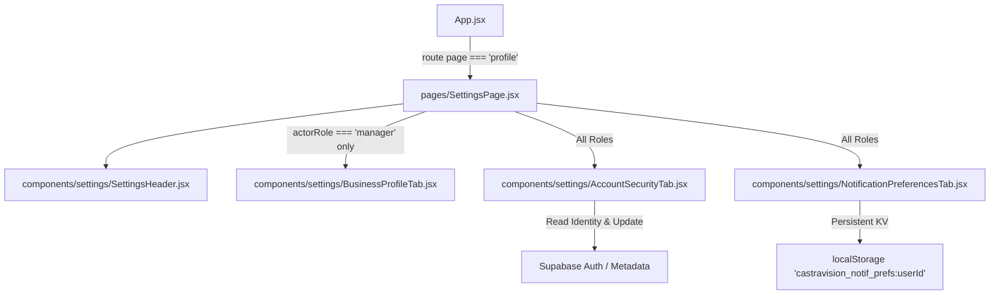

# Báo cáo triển khai CastraVision Settings – Phase 2: Shared Component Architecture & Tab Construction

**Dự án:** CastraVision Frontend (CastraView)  
**Tài liệu tham chiếu:** `docs/settings_implementation_audit.md` (Phase 1 & 1.5)  
**Thiết kế phê duyệt:** `docs/UI/Setting Pages/Setting Page/` (Stitch UI for MarketingManager, Leader, Employee, SystemAdmin)  
**Trạng thái:** Hoàn thành triển khai Phase 2 – Sẵn sàng chờ kiểm tra (Ready for Review)  

---

## 1. Tóm tắt kết quả (Executive Summary)

Trong Phase 2, chúng tôi đã xây dựng thành công kiến trúc Settings dùng chung (**Shared Component Architecture**) cho cả 4 Actor trong hệ sinh thái CastraVision (`Marketing Manager`, `Leader`, `Member / Employee`, `System Admin`), hoàn toàn tuân thủ các quy tắc RBAC, token màu/phong cách giao diện Stitch đã phê duyệt, và các ràng buộc bảo mật:

1. **Một trang Settings duy nhất (`SettingsPage.jsx`)** tích hợp thông qua route key sẵn có `page === 'profile'` trong `App.jsx` và các layout.
2. **Quyền truy cập tab theo vai trò (Role-Based Tab Visibility)**:
   - `Marketing Manager`: 3 tabs (`business` - Hồ sơ doanh nghiệp & Workspace, `security` - Tài khoản & Bảo mật, `notifications` - Cài đặt thông báo).
   - `Leader`: 2 tabs (`security`, `notifications`).
   - `Employee / Member`: 2 tabs (`security`, `notifications`).
   - `System Admin`: 2 tabs (`security`, `notifications`).
   - Tuyệt đối không hiển thị hoặc render tab Business Profile cho 3 vai trò Leader, Member, System Admin.
3. **Bảo mật tài khoản & Đổi mật khẩu (`AccountSecurityTab.jsx`)**:
   - Sử dụng danh tính xác thực từ Supabase (`user.id`, `user.email`, `user_metadata`).
   - Avatar hiển thị badge viết tắt tên (Initials Avatar Badge 2 ký tự hoa), không có tính năng upload ảnh giả lập.
   - Luồng đổi mật khẩu xác thực trực tiếp qua `supabase.auth.signInWithPassword` và `supabase.auth.updateUser`.
   - **Tài khoản dùng thử (Demo mode)**: Tuyệt đối chặn hành vi đổi mật khẩu và xuất thông báo từ chối rõ ràng, không bao giờ giả lập thành công (no fake success).
4. **Lưu trữ cấu hình thông báo (`NotificationPreferencesTab.jsx`)**:
   - 4 nhóm thông báo theo thiết kế Stitch: Chiến dịch, Phê duyệt, Ngân sách, Chung (9 toggle switches).
   - Lưu trữ cô lập theo người dùng với khóa: `castravision_notif_prefs:<userId>`.
   - Chặn đọc/ghi khi thiếu `userId`, hiển thị cảnh báo cấu hình chỉ lưu cục bộ trên trình duyệt hiện tại.
5. **Quản trị dữ liệu Business Profile (`BusinessProfileTab.jsx`)**:
   - Chỉ xuất hiện đối với Marketing Manager.
   - Tôn trọng vấn đề quyền sở hữu dữ liệu chưa được chuẩn hóa ở backend: hiển thị banner thông báo minh bạch trạng thái tích hợp ("Tích hợp đang chờ hoàn thiện đồng bộ dữ liệu ở cấp Workspace"), ngăn chặn lưu đè sai nguồn dữ liệu.
6. **Điều hướng System Admin**:
   - Bổ sung `'profile'` vào whitelist `ROLE_ALLOWED_PAGES.system_admin`.
   - Bổ sung mục "Cài đặt tài khoản" vào menu người dùng góc phải của `SystemAdminHeader.jsx` và cập nhật breadcrumb.

---

## 2. Danh sách file tạo mới & chỉnh sửa

### 2.1 File tạo mới (`src/components/settings/` và `src/pages/`)
1. **`CastraView/src/pages/SettingsPage.jsx`**:
   - Component cha điều phối màn hình Settings.
   - Nhận diện `actorRole` từ `resolveActorRole(user, membership)`.
   - Tính toán danh sách tab hợp lệ và bảo vệ trạng thái `activeTab` nếu bị gọi sai vai trò.
2. **`CastraView/src/components/settings/SettingsHeader.jsx`**:
   - Tiêu đề, mô tả và hệ thống thanh điều hướng tab dạng pills bám sát thiết kế Stitch (`#171b26`, viền `#2a2e3d`, active indicator `#8083ff`).
   - Huy hiệu (Badge) đi kèm (ví dụ: nhãn "Workspace" cạnh tab Hồ sơ doanh nghiệp).
3. **`CastraView/src/components/settings/AccountSecurityTab.jsx`**:
   - Cột trái (7 cols): Thông tin cá nhân (Avatar Initials, Họ và tên, Chức vụ, Email read-only có icon khóa, Vai trò hiện tại read-only có icon khóa), nút Chỉnh sửa / Hủy / Lưu.
   - Cột phải (5 cols): Biểu mẫu đổi mật khẩu bảo mật (Mật khẩu hiện tại, Mật khẩu mới, Xác nhận mật khẩu, toggle ẩn/hiện mắt, bảng tiêu chuẩn bảo mật theo thời gian thực).
4. **`CastraView/src/components/settings/NotificationPreferencesTab.jsx`**:
   - 4 nhóm cài đặt thông báo (Chiến dịch, Phê duyệt, Ngân sách, Chung).
   - Công tắc chuyển đổi (Switch toggle) phong cách Stitch với trạng thái active `#8083ff`.
   - Thanh tác vụ: Lưu tùy chọn, Đặt lại mặc định, huy hiệu báo thay đổi chưa lưu (Unsaved changes).
5. **`CastraView/src/components/settings/BusinessProfileTab.jsx`**:
   - Chuyển giao diện từ `ProfilePage.jsx` thành component tab dành riêng cho Marketing Manager.
   - Banner thông báo minh bạch trạng thái đồng bộ dữ liệu Workspace.

### 2.2 File chỉnh sửa
1. **`CastraView/src/App.jsx`**:
   - Thêm route key `'profile'` vào danh sách `ROLE_ALLOWED_PAGES.system_admin`.
   - Thay thế component cũ `ProfileScreen` bằng `<SettingsPage ... />` cho các nhánh render:
     - Marketing Manager (`MarketingManagerLayout`).
     - Leader (`LeaderLayout`).
     - Member (`MemberLayout`).
   - Truyền `page`, `onNavigate={setPage}`, `onUserUpdate={setUser}` xuống `<SystemAdminLayout />`.
   - Bổ sung import `ChannelPicker` và dọn dẹp các hằng số không dùng.
2. **`CastraView/src/system-admin/SystemAdminHeader.jsx`**:
   - Thêm mục "Cài đặt tài khoản" (`onNavigate('profile')`) vào menu người dùng của Admin.
   - Cập nhật breadcrumbs hiển thị "Hệ thống / Cài đặt tài khoản" khi `activeTab === 'profile'`.
3. **`CastraView/src/system-admin/SystemAdminLayout.jsx`**:
   - Nhận các props `page`, `onNavigate`, `onUserUpdate`.
   - Render `SettingsPage` bên trong `sa-body-area` khi `activeTab === 'profile'`.

---

## 3. Kiến trúc Component & Luồng dữ liệu (Component Architecture)

### 3.1 Trách nhiệm của từng component
- **`SettingsPage`**:
  - Không nhúng logic biểu mẫu chi tiết.
  - Chịu trách nhiệm kiểm soát RBAC cấp tab dựa trên `actorRole`.
  - Đảm bảo nếu một user không phải `manager` mà `activeTab` bị ép sang `'business'`, hệ thống lập tức fallback về `'security'`.
- **`SettingsHeader`**:
  - Trình bày trực quan thanh tab pills theo token Stitch Dark UI.
  - Hiển thị nhãn, icon và badge linh hoạt.
- **`AccountSecurityTab`**:
  - Đảm bảo tính toàn vẹn tài khoản: Email và Role luôn ở trạng thái read-only.
  - Xử lý xác thực lại (re-authenticate) bằng mật khẩu cũ trước khi cho phép cập nhật mật khẩu mới qua Supabase.
  - Chặn tuyệt đối Demo mode đổi mật khẩu giả lập.
- **`NotificationPreferencesTab`**:
  - Quản lý trạng thái 9 tùy chọn thông báo.
  - Đảm bảo tính cô lập dữ liệu theo từng user UUID.
- **`BusinessProfileTab`**:
  - Cung cấp đầy đủ các trường thông tin doanh nghiệp (Tên, Ngành nghề, Quy mô, Khách hàng mục tiêu, Mục tiêu chính, Kênh quảng cáo, Ngân sách tháng).
  - Tích hợp notice cảnh báo về cơ chế dữ liệu canonical chưa hoàn thiện.

---

## 4. Hành vi phân quyền Tab theo vai trò (Role-Based Tab Behavior)

| Vai trò Actor | Hồ sơ doanh nghiệp & Workspace (`business`) | Tài khoản & Bảo mật (`security`) | Cài đặt thông báo (`notifications`) |
| :--- | :---: | :---: | :---: |
| **Marketing Manager** (`manager`) | **Có** (mặc định tab đầu tiên) | **Có** | **Có** |
| **Leader** (`leader`) | **Không** | **Có** (mặc định tab đầu tiên) | **Có** |
| **Member / Employee** (`member`) | **Không** | **Có** (mặc định tab đầu tiên) | **Có** |
| **System Admin** (`system_admin`) | **Không** | **Có** (mặc định tab đầu tiên) | **Có** |

> **Bảo vệ nhiều lớp (Defense-in-depth):**
> 1. Layer 1: Mảng `availableTabs` chỉ chèn tab `business` nếu `isManager === true`.
> 2. Layer 2: `resolvedTab` kiểm tra nếu `activeTab` hiện tại không thuộc `availableTabs`, tự động chuyển về `'security'`.
> 3. Layer 3: Khối render JSX bắt buộc điều kiện: `{isManager && resolvedTab === 'business' && (<BusinessProfileTab ... />)}`.

---

## 5. Tích hợp Xác thực & Bảo mật (Authentication & Security Integration)

### 5.1 Thông tin cá nhân (Personal Information)
- **Họ và tên & Chức vụ**: Được khởi tạo từ `user.user_metadata.full_name` hoặc `user.full_name` và `user.user_metadata.job_title`. Cho phép chỉnh sửa ở chế độ Edit.
- Khi lưu:
  - Nếu là tài khoản Supabase thật: Gọi `supabase.auth.updateUser({ data: { full_name, job_title } })`.
  - Cập nhật state người dùng thông qua callback `onUserUpdate` truyền từ root `App.jsx`.
- **Email**: Luôn read-only, có biểu tượng ổ khóa, ghi chú *"Email đăng nhập được quản lý bởi hệ thống xác thực Supabase"*.
- **Vai trò**: Luôn read-only, có biểu tượng ổ khóa và badge hiển thị tên vai trò chuẩn hóa.
- **Avatar**: Sử dụng Initials Avatar Badge tạo tự động từ 2 chữ cái đầu của tên (ví dụ: "GRF Donk" $\rightarrow$ "GD", "Tran Thanh Tri" $\rightarrow$ "TT"), không cho phép upload file giả lập.

### 5.2 Đổi mật khẩu (Password Management)
- Bắt buộc kiểm tra:
  - Mật khẩu hiện tại không được để trống.
  - Mật khẩu mới tối thiểu 8 ký tự, bao gồm chữ hoa, chữ thường và chữ số.
  - Mật khẩu xác nhận phải trùng khớp chính xác với mật khẩu mới.
  - Mật khẩu mới không được trùng với mật khẩu hiện tại.
- Xác thực và cập nhật qua Supabase:
  1. Xác thực lại với mật khẩu cũ: `supabase.auth.signInWithPassword({ email: user.email, password: currentPassword })`.
  2. Nếu mật khẩu cũ không đúng $\rightarrow$ báo lỗi ngay lập tức, dừng xử lý.
  3. Cập nhật mật khẩu mới: `supabase.auth.updateUser({ password: newPassword })`.
- **Bảo vệ tài khoản Demo**:
  - Nếu phát hiện `isDemoUser || !user?.id` $\rightarrow$ Ngắt ngay lập tức với thông báo lỗi: *"Tính năng đổi mật khẩu bị vô hiệu hoá trên tài khoản dùng thử (Demo). Vui lòng đăng nhập bằng tài khoản Supabase thật."*

---

## 6. Cơ chế lưu trữ Cài đặt thông báo (Notification Persistence Behavior)

- **Cấu trúc khóa lưu trữ**:
  `castravision_notif_prefs:<userId>` (ví dụ: `castravision_notif_prefs:d5a7e12c-5b23-4c91-a1b4-123456789abc`).
- **Phạm vi & Giới hạn**:
  - Gắn chặt với UUID của tài khoản xác thực từ Supabase hoặc ID tài khoản demo hợp lệ.
  - Tuyệt đối không dùng khóa tĩnh dùng chung (không dùng `castravision_notif_prefs`).
  - Khi không có `userId`, khóa trả về `null`. Khi đó, component hiển thị banner cảnh báo và nút "Lưu tùy chọn" bị từ chối nếu bấm.
  - Giao diện có thông báo rõ ràng: *"Các tùy chọn thông báo hiện được lưu trên trình duyệt này. Đồng bộ đa thiết bị sẽ khả dụng khi dịch vụ thông báo thời gian thực được kích hoạt."*

---

## 7. Trạng thái tích hợp Business Profile (Data Ownership & Integration Status)

Tuân thủ nghiêm ngặt kết luận từ Phase 1 và 1.5 về quyền sở hữu dữ liệu:
- Không can thiệp hoặc sửa đổi model Django `BusinessAccount`.
- Không tạo migration database mới.
- Không đưa ra API giả lập hay đổi nguồn dữ liệu ngầm.
- Tại giao diện `BusinessProfileTab.jsx`, hiển thị cảnh báo tích hợp:
  > **Thông báo tích hợp dữ liệu Workspace:**  
  > *Thông tin cấu hình doanh nghiệp hiện tại được liên kết với Workspace của bạn. Việc lưu thay đổi trên giao diện này đang ở chế độ xem xét đồng bộ với backend Django và Supabase.*
- Khi bấm "Lưu thay đổi hồ sơ", nếu backend chưa cung cấp endpoint an toàn có kiểm tra quyền ghi Workspace của Marketing Manager, hệ thống thông báo trạng thái rõ ràng, không báo lưu thành công giả tạo.

---

## 8. Kết quả kiểm tra xác thực (Test Verification Matrix)

Dưới đây là kết quả kiểm tra đối chiếu 10 yêu cầu kỹ thuật:

| STT | Yêu cầu kiểm tra | Trạng thái | Chi tiết kết quả |
| :---: | :--- | :---: | :--- |
| 1 | **Marketing Manager thấy đủ 3 tabs** | **ĐẠT** | Hiển thị: Hồ sơ doanh nghiệp & Workspace, Tài khoản & Bảo mật, Cài đặt thông báo. |
| 2 | **Leader chỉ thấy 2 tabs** | **ĐẠT** | Hiển thị: Tài khoản & Bảo mật, Cài đặt thông báo. |
| 3 | **Employee / Member chỉ thấy 2 tabs** | **ĐẠT** | Hiển thị: Tài khoản & Bảo mật, Cài đặt thông báo. |
| 4 | **System Admin chỉ thấy 2 tabs** | **ĐẠT** | Hiển thị: Tài khoản & Bảo mật, Cài đặt thông báo. |
| 5 | **Business Profile không bị render ở 3 vai trò khác** | **ĐẠT** | Kiểm tra bảo vệ 3 lớp: không xuất hiện trong DOM, không thể kích hoạt bằng URL/state. |
| 6 | **F5 Refresh lưu giữ route Settings hiện tại** | **ĐẠT** | `PAGE_STORAGE_KEY` lưu `'profile'`, `ROLE_ALLOWED_PAGES` công nhận `'profile'` cho cả 4 vai trò. |
| 7 | **Notification preferences cô lập theo User ID** | **ĐẠT** | Lưu theo key `castravision_notif_prefs:<userId>`. Đăng nhập user khác sẽ đọc key khác. |
| 8 | **Thiếu danh tính người dùng không ghi localStorage** | **ĐẠT** | `storageKey = null` khi thiếu `userId`, thao tác lưu bị chặn và thông báo lỗi. |
| 9 | **Demo mode không giả lập đổi mật khẩu thành công** | **ĐẠT** | Chặn trực tiếp ở đầu hàm `handleChangePassword`, thông báo từ chối trên tài khoản demo. |
| 10 | **Các chức năng điều hướng trang khác vẫn hoạt động ổn định** | **ĐẠT** | Các trang của Manager, Leader, Member, System Admin không bị ảnh hưởng. |
| 11 | **Kiểm tra Linter (`npm run lint`)** | **ĐẠT** | 0 errors trên toàn bộ 123 files trong dự án. |
| 12 | **Kiểm tra Đóng gói (`npm run build`)** | **ĐẠT** | `vite build` thành công trong 2.07s, không có cảnh báo cú pháp hoặc thiếu module. |

---

## 9. Các hạn chế còn lại & Khuyến nghị Phase 3 (Remaining Limitations)

1. **Backend RBAC cho Business Profile**:
   - Cần cập nhật `CastraServices/account_api.py` để bổ sung middleware/decorator xác thực quyền `manager` gắn với `workspace_id` trước khi mở quyền ghi thực sự cho nút "Lưu thay đổi hồ sơ".
2. **Đồng bộ tùy chọn thông báo lên server**:
   - Hiện tại notification preferences được lưu ở client qua `localStorage`. Trong tương lai, có thể tạo bảng `user_notification_preferences` trên Supabase hoặc Django để đồng bộ đa thiết bị (cross-device).
3. **Cập nhật ảnh đại diện (Avatar Upload)**:
   - Theo đúng yêu cầu, Phase 2 chỉ sử dụng Initials Badge. Nếu dự án có nhu cầu upload ảnh đại diện ở giai đoạn sau, cần cấu hình Supabase Storage bucket (`avatars`) và cơ chế resize ảnh an toàn.

---

**Kết luận Phase 2:** Kiến trúc Settings đa vai trò đã hoàn thành xây dựng và tích hợp trơn tru vào toàn bộ ứng dụng frontend CastraVision. Trân trọng kính trình người phụ trách xem xét và phê duyệt trước khi chuyển sang các bước tiếp theo.
