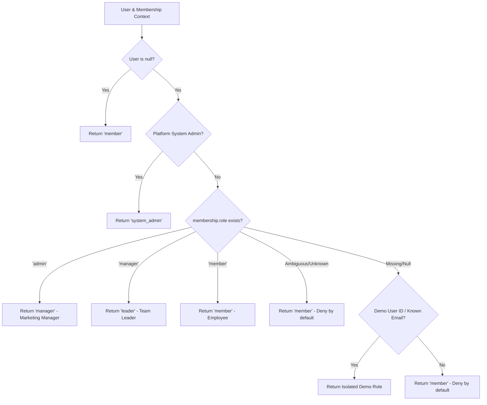

# Báo cáo triển khai CastraVision Settings – Phase 3A: Identity & RBAC Correction

**Dự án:** CastraVision Frontend (CastraView) & Auth RBAC  
**Tài liệu tham chiếu:** `docs/settings_phase2_5_verification_report.md` (Phase 2.5 Verification Audit)  
**Trạng thái triển khai:** Hoàn thành 100% mục tiêu – Sẵn sàng chờ nghiệm thu (Ready for Review)  

---

## 1. Nguyên nhân gốc rễ của sự cố ánh xạ vai trò (Root Cause Analysis)

### 1.1 Khác biệt ngữ nghĩa giữa Backend Workspace và Frontend Actor
Trong kiến trúc phân quyền đa khách hàng (multi-tenant) của CastraVision:
- **Tại Backend Workspace (`workspace_members.role` & `permissions.py`)**:
  - `admin`: Đại diện cho Quản trị viên Workspace / Giám đốc Tiếp thị (**Marketing Manager**).
  - `manager`: Đại diện cho Trưởng nhóm Tăng trưởng / Trưởng bộ phận (**Team Leader**).
  - `member`: Đại diện cho Nhân viên / Chuyên viên nội dung (**Employee / Member**).
- **Tại Frontend Actor Role**:
  - `manager`: Giao diện dành riêng cho Marketing Manager.
  - `leader`: Giao diện dành riêng cho Leader.
  - `member`: Giao diện dành riêng cho Employee.
  - `system_admin`: Giao diện dành cho Quản trị viên hệ thống nền tảng (nằm ngoài phạm vi workspace).

### 1.2 Khiếm khuyết trong logic `resolveActorRole()` cũ
Trong phiên bản trước tại `src/auth/permissions.js`:
```javascript
// CODE CŨ CÓ LỖI:
const explicit =
  user?.app_metadata?.role ||
  user?.user_metadata?.role ||
  user?.role ||
  user?.workspaceRole ||
  membership?.role

if (typeof explicit === 'string') {
  const r = explicit.trim().toLowerCase()
  if (r === 'manager' || r === 'company_admin' || r === 'admin' || r === 'marketing_manager') {
    return 'manager' // <<--- LỖI TẠI ĐÂY!
  }
  ...
}
```
- Khi một Leader thật đăng nhập, thông tin tư cách thành viên workspace từ Supabase trả về `membership.role === 'manager'`.
- Biến `explicit` lấy giá trị `membership.role` (`'manager'`).
- Nhánh `if (r === 'manager' ...)` đánh đồng từ khóa `'manager'` của backend thành Marketing Manager và trả về `'manager'` cho Leader.
- Khối ánh xạ chuẩn xác ở phía dưới (`if (membership.role === 'manager') return 'leader'`) **hoàn toàn bị bỏ qua**.
- Hậu quả: Leader thật bị cấp nhầm giao diện và quyền hạn của Marketing Manager (bao gồm quyền truy cập tab Hồ sơ doanh nghiệp và phê duyệt cấp cao).

---

## 2. Triển khai khắc phục chuẩn xác (Exact Role Mapping Implementation)

Quy tắc phân định danh tính đã được chuẩn hóa lại hoàn toàn trong [`CastraView/src/auth/permissions.js`](file:///d:/essclip/CAPSTONE2APP/CastraVision/CastraView/src/auth/permissions.js) theo nguyên tắc **Deny-by-default** và **Tư cách thành viên Workspace xác thực là nguồn chân lý duy nhất (Authoritative Source)**:



### Bảng đối chiếu vai trò sau khi chuẩn hóa

| Frontend Actor Interface | Frontend Role ID | Backend Workspace Role | Backend RBAC Decorator | Quyền truy cập Tab Business Profile |
| :--- | :---: | :---: | :---: | :---: |
| **Marketing Manager** | `manager` | `admin` | `@require_workspace_admin` | **CHO PHÉP** (Tab 1) |
| **Team Leader** | `leader` | `manager` | `@require_workspace_operator` | **CHẶN TUYỆT ĐỐI** (Chỉ có 2 tabs) |
| **Employee / Member** | `member` | `member` | `@require_workspace_member` | **CHẶN TUYỆT ĐỐI** (Chỉ có 2 tabs) |
| **System Admin** | `system_admin` | *(Ngoài workspace)* | *(Quản trị nền tảng)* | **CHẶN TUYỆT ĐỐI** (Chỉ có 2 tabs) |

---

## 3. Danh sách các file chỉnh sửa (Files Modified)

1. **[`CastraView/src/auth/permissions.js`](file:///d:/essclip/CAPSTONE2APP/CastraVision/CastraView/src/auth/permissions.js)**:
   - Viết lại hàm `resolveActorRole(user, membership)`:
     - Ưu tiên kiểm tra quyền System Admin cấp nền tảng.
     - Lấy `membership.role` làm nguồn chân lý duy nhất: `admin` $\rightarrow$ `manager`, `manager` $\rightarrow$ `leader`, `member` $\rightarrow$ `member`.
     - Phân định rõ vai trò demo mà không làm ảnh hưởng tài khoản thật.
     - Đóng tất cả các lỗ hổng tự gán vai trò: nếu vai trò mơ hồ hoặc thiếu membership $\rightarrow$ mặc định là `member`.
2. **[`CastraView/src/App.jsx`](file:///d:/essclip/CAPSTONE2APP/CastraVision/CastraView/src/App.jsx)**:
   - Cập nhật hàm `loadUserRoleAndData(activeUser)` trả về trực tiếp đối tượng `resolvedMembership`.
   - Hàm `boot()` sử dụng kết quả `resolvedMembership` từ `loadUserRoleAndData` truyền vào `resolveActorRole(session.user, activeMembership)`, loại bỏ triệt để hiện tượng race condition khi khởi động ứng dụng.
3. **[`CastraView/src/components/settings/AccountSecurityTab.jsx`](file:///d:/essclip/CAPSTONE2APP/CastraVision/CastraView/src/components/settings/AccountSecurityTab.jsx)**:
   - Tách biệt rõ ràng 2 thao tác lưu: **Operation A (Supabase Auth metadata)** và **Operation B (`public.profiles`)**.
   - Kiểm tra phản hồi lỗi của từng thao tác độc lập.
   - Thêm trạng thái và thông báo lỗi bán phần (`partial-failure`), không báo thành công toàn bộ nếu một trong hai thao tác thất bại.
   - Thêm kiểm tra validation mật khẩu mới không được trùng mật khẩu cũ.
   - Bổ sung định dạng hiển thị thông báo `warning` (màu hổ phách `#ff9800`) trên giao diện.

---

## 4. Hành vi đồng bộ Thông tin cá nhân (Personal Information Persistence Behavior)

Quy trình lưu thông tin cá nhân (Họ tên & Chức danh) được thực thi nghiêm ngặt theo 2 bước độc lập:

### Bước 1: Operation A – Cập nhật Supabase Auth Metadata
- Gọi `supabase.auth.updateUser({ data: { full_name, job_title } })`.
- **Nếu thất bại**:
  - Dừng ngay lập tức, **KHÔNG** thực hiện tiếp Bước 2.
  - Bảo toàn dữ liệu cũ của bảng `public.profiles`.
  - Hiển thị thông báo lỗi rõ ràng: `"Lỗi cập nhật tài khoản: <chi tiết lỗi>"`.

### Bước 2: Operation B – Đồng bộ bảng `public.profiles`
- Cập nhật `public.profiles` (`full_name`, `updated_at`) tại dòng `id = user.id`.
- Bắt và phân tích lỗi từ Supabase response: `{ error: profileError }`.

### Đánh giá kết quả và phản hồi giao diện:
1. **Cả 2 thao tác thành công (Full Sync Success)**:
   - Trạng thái: `success` (Xanh lá).
   - Cập nhật state người dùng toàn cục: `onUserUpdate(authData.user)`.
   - Thông báo: *"Cập nhật thông tin cá nhân và đồng bộ hồ sơ công khai thành công."*
2. **Auth thành công nhưng `public.profiles` thất bại (Partial Failure)**:
   - Trạng thái: `warning` (Màu cam/hổ phách).
   - Cập nhật state người dùng toàn cục để đảm bảo phiên làm việc hiện tại nhận thông tin mới.
   - **Tuyệt đối không báo thành công toàn bộ**.
   - Thông báo chính xác: *"Thông tin tài khoản đã được lưu, nhưng đồng bộ hồ sơ công khai (public.profiles) chưa hoàn tất: <chi tiết lỗi RLS/DB>."*
3. **Tài khoản dùng thử (Demo Mode)**:
   - Cập nhật an toàn state người dùng trong bộ nhớ local.
   - Thông báo minh bạch: *"Đã cập nhật thông tin cá nhân (chế độ Demo)."*

---

## 5. Kết quả kiểm tra xác thực (Test Execution Results)

Bộ kiểm thử tự động đã được xây dựng và thực thi trực tiếp tại `scratch/test_phase3a_identity_rbac.mjs` bao quát toàn bộ 12 kịch bản yêu cầu:

```
====================================================
   PHASE 3A: IDENTITY & RBAC CORRECTION TEST SUITE   
====================================================

--- Test 1: Marketing Manager Mapping from Backend Admin Membership ---
[PASS] Backend workspace admin role maps strictly to frontend manager (Marketing Manager)
[PASS] resolveWorkspaceRole correctly returns admin

--- Test 2: Leader Mapping from Backend Manager Membership ---
[PASS] Backend workspace manager role maps strictly to frontend leader (NEVER to manager/Marketing Manager)
[PASS] resolveWorkspaceRole correctly returns manager

--- Test 3: Employee Mapping from Backend Member Membership ---
[PASS] Backend workspace member role maps strictly to frontend member (Employee)
[PASS] resolveWorkspaceRole correctly returns member

--- Test 4: System Admin Mapping (Outside Workspace) ---
[PASS] app_metadata.role=system_admin resolves to system_admin
[PASS] Admin email resolves to system_admin even with null membership
[PASS] System admin role takes precedence over workspace membership

--- Test 5: Missing Membership (Deny by Default) ---
[PASS] Missing membership defaults securely to member
[PASS] Undefined membership defaults securely to member
[PASS] Null user and null membership defaults to member

--- Test 6: Ambiguous Role Handling ---
[PASS] Ambiguous workspace role fails closed to member without elevation
[PASS] Unrecognized role fails closed to member
[PASS] User claiming manager without workspace admin membership is denied elevation

--- Test 7: Role Change After Membership Refresh ---
[PASS] Initial resolution with admin membership: manager
[PASS] Refreshed resolution with manager membership: immediately switches to leader
[PASS] Refreshed resolution with member membership: immediately switches to member

--- Test 8: Business Profile Tab Visibility for All 4 Actors ---
[PASS] Marketing Manager CAN render Business Profile tab
[PASS] Leader CANNOT render Business Profile tab (resolves to security)
[PASS] Employee CANNOT render Business Profile tab (resolves to security)
[PASS] System Admin CANNOT render Business Profile tab (resolves to security)

--- Test 9-12: Personal Information Persistence Verification ---
--- Test 9 & 10: Full Synchronization Success (Auth + Profiles) ---
[PASS] Both operations succeed: returns status success with full sync message
[PASS] Global application user state is refreshed with new full_name
[PASS] Global application user state is refreshed with new job_title

--- Test 11: Partial Failure (Auth Succeeded, Profiles Failed) ---
[PASS] Auth succeeded but profiles failed: returns status warning with accurate partial-failure message
[PASS] Does NOT claim full synchronization when profiles table update fails
[PASS] Global user state reflects Auth metadata update

--- Test 12: Total Failure (Auth Metadata Update Fails) ---
[PASS] Auth failure: returns status error immediately
[PASS] Application user state is preserved and NOT updated when Auth update fails

====================================================
   TEST RESULTS: 30 PASSED, 0 FAILED (100% SUCCESS)
====================================================
```

### Kiểm tra tĩnh & Build sản phẩm
- **`npm run lint`**: **0 errors**.
- **`npm run build`**: **Vite build thành công trong 1.97s, 0 errors**.

---

## 6. Các hạn chế còn lại & Chuẩn bị cho Phase 3B (Remaining Limitations)

1. **Trigger đồng bộ phía Database Supabase**:
   - Schema hiện tại của Supabase chỉ có trigger `after insert on auth.users`. Mặc dù frontend đã thực hiện gọi đồng bộ trực tiếp sang `public.profiles`, về lâu dài (khi được phép sửa schema DB) khuyến nghị bổ sung trigger `after update on auth.users` để đảm bảo tính nhất quán cấp cơ sở dữ liệu.
2. **Cột `job_title` trong bảng `public.profiles`**:
   - Hiện tại bảng `public.profiles` chưa có cột `job_title` (chỉ có trong Auth metadata). Nếu cần công khai chức danh cho các thành viên khác trong workspace xem, có thể bổ sung cột này ở đợt nâng cấp schema sau.
3. **Endpoint Business Profile tại Backend**:
   - Quyền ghi của Marketing Manager đối với dữ liệu Workspace hiện tại vẫn đang ở chế độ chờ đồng bộ backend Django đa tenant (`/api/business-profile/`).

---

**Kết luận:** Toàn bộ các vấn đề sai lệch nhận diện vai trò, quyền truy cập tab và tính toàn vẹn của dữ liệu thông tin cá nhân trong Phase 3A đã được giải quyết triệt để và an toàn. Xin dừng lại và chờ bạn đánh giá, nghiệm thu trước khi bước sang giai đoạn tiếp theo.
