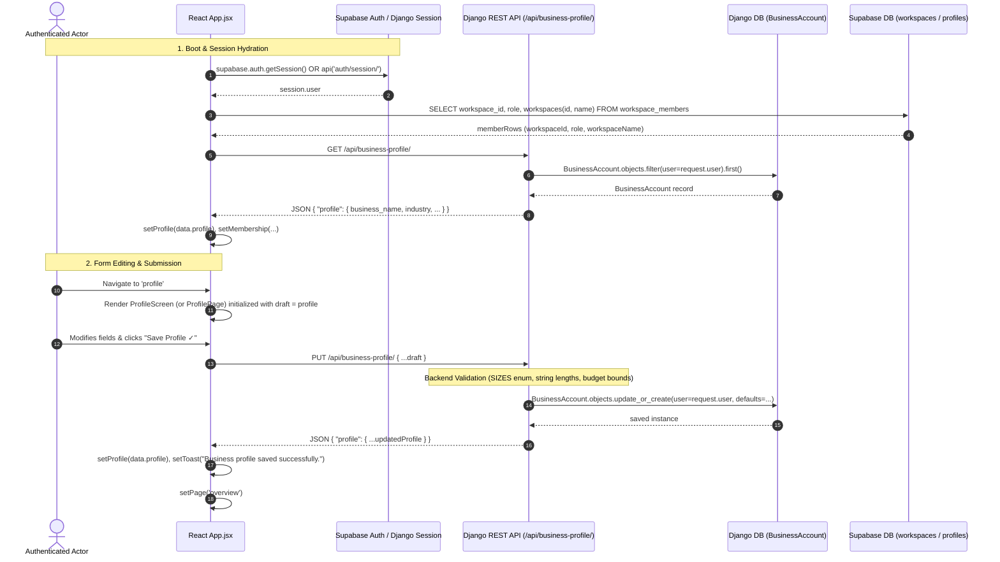
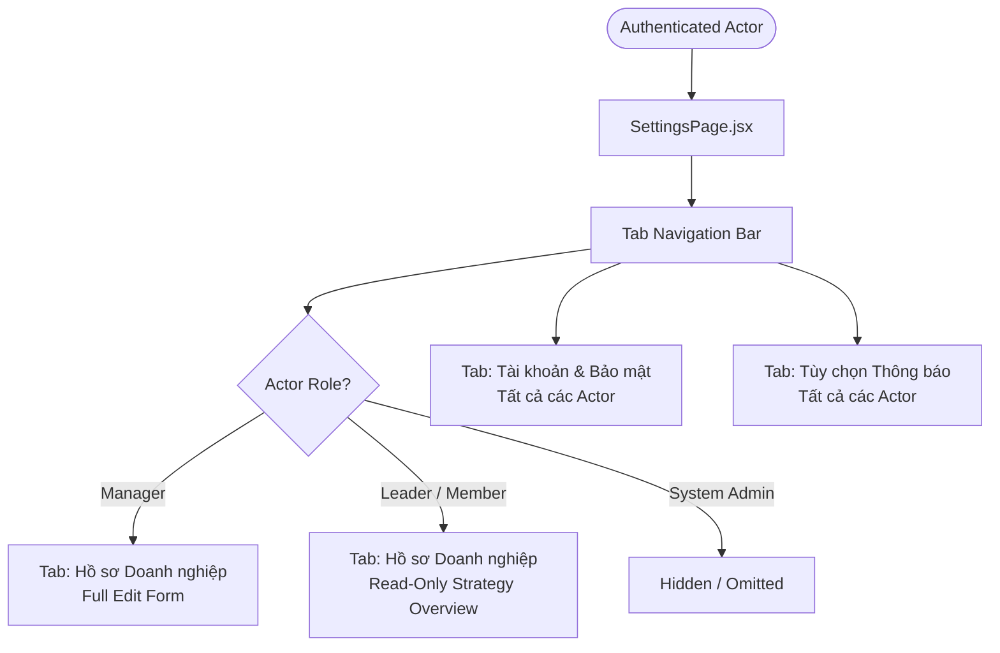

# Step 5A – Read-Only Audit: Settings & Profile Architecture

**Project:** CastraVision Frontend  
**Investigation Date:** 2026-11-14  
**Audit Type:** Read-Only Technical Architecture & Implementation Audit  
**Target:** Settings & Profile Architecture across all Actors (Marketing Manager, Leader, Employee, System Admin)

---

## 1. Executive Summary

This audit assesses the current state of Settings and Profile features in CastraVision prior to designing and implementing a unified, role-aware Settings module.

### Key Audit Findings:
1. **Misaligned Page Scope:** When users navigate to `profile` (labeled variously as "Settings", "Account Settings", or "My Profile"), the application currently renders an inline `ProfileScreen` ([App.jsx:280-425](file:///d:/essclip/CAPSTONE2APP/CastraVision/CastraView/src/App.jsx#L280-L425)). This component is exclusively a **Company Onboarding / Business Profile form** (Company Name, Industry, Size, Target Audience, Goals, Monthly Budget, Channels). It contains **zero personal account settings, zero password controls, and zero notification preferences**.
2. **Identical Rendering Across Non-Admin Actors:** Marketing Manager, Leader, and Member all render the exact same `ProfileScreen` with full edit and save capabilities via `PUT /api/business-profile/`. Under the CastraVision RBAC specification ([docs/superpowers/specs/2026-10-06-supabase-auth-rls-design.md](file:///d:/essclip/CAPSTONE2APP/CastraVision/docs/superpowers/specs/2026-10-06-supabase-auth-rls-design.md)), only the Company Admin / Marketing Manager should have write access to `business_profiles`, while Leaders and Members should only have read access or personal account settings.
3. **Orphaned Component Discovery:** A modern Tailwind v4 + shadcn/ui component ([ProfilePage.jsx](file:///d:/essclip/CAPSTONE2APP/CastraVision/CastraView/src/pages/ProfilePage.jsx)) was previously created in `src/pages/` but is **completely unreferenced and never imported** anywhere in the active application. Instead, `App.jsx` continues to render the legacy inline `ProfileScreen` using deprecated CSS classes (`shell`, `stepper`, `card profile-card`, `form-grid`).
4. **Complete Absence of Personal Account & Notification Capabilities:** Across all files, avatar uploads, password modification (`supabase.auth.updateUser`), email changing, in-app notification preference toggles, email notification subscriptions, theme switching, and language selection are **completely unimplemented** (classified as "Not Implemented" or "Static UI Only").
5. **System Admin Isolation:** The System Admin role currently operates on a dedicated tenant management shell ([SystemAdminLayout.jsx](file:///d:/essclip/CAPSTONE2APP/CastraVision/CastraView/src/system-admin/SystemAdminLayout.jsx)) that does not register the `profile` route in `ROLE_ALLOWED_PAGES` ([App.jsx:1051-1054](file:///d:/essclip/CAPSTONE2APP/CastraVision/CastraView/src/App.jsx#L1051-L1054)) and has no access to personal profile configuration beyond viewing their static email in the header dropdown.

---

## 2. Existing Settings Navigation

### 2.1 Navigation Audit by Actor

| Actor | Layout Shell | Nav Location & Label | Trigger Key | Current Rendered Component |
| :--- | :--- | :--- | :--- | :--- |
| **Marketing Manager** (`manager`) | [MarketingManagerLayout.jsx](file:///d:/essclip/CAPSTONE2APP/CastraVision/CastraView/src/company-admin/MarketingManagerLayout.jsx) | Sidebar: "Settings"<br>Dashboard: "Workspace Settings"<br>Header Dropdown: "Account Profile" | `profile` | Inline `ProfileScreen` in [App.jsx:1471-1480](file:///d:/essclip/CAPSTONE2APP/CastraVision/CastraView/src/App.jsx#L1471-L1480) |
| **Leader** (`leader`) | [LeaderLayout.jsx](file:///d:/essclip/CAPSTONE2APP/CastraVision/CastraView/src/leader/LeaderLayout.jsx) | Sidebar: "Account Settings"<br>Header Dropdown: "Account Settings" | `profile` | Inline `ProfileScreen` in [App.jsx:1571-1580](file:///d:/essclip/CAPSTONE2APP/CastraVision/CastraView/src/App.jsx#L1571-L1580) |
| **Employee** (`member`) | [MemberLayout.jsx](file:///d:/essclip/CAPSTONE2APP/CastraVision/CastraView/src/member/MemberLayout.jsx) | Sidebar: "My Profile"<br>Header Dropdown: "My Profile & Settings" | `profile` | Inline `ProfileScreen` in [App.jsx:1708-1717](file:///d:/essclip/CAPSTONE2APP/CastraVision/CastraView/src/App.jsx#L1708-L1717) |
| **System Admin** (`system_admin`) | [SystemAdminLayout.jsx](file:///d:/essclip/CAPSTONE2APP/CastraVision/CastraView/src/system-admin/SystemAdminLayout.jsx) | None in sidebar.<br>Header Dropdown shows email and Sign Out only. | N/A (`sa-dashboard`, `sa-company-mgmt`) | N/A (`profile` route blocked by `ROLE_ALLOWED_PAGES`) |

### 2.2 Route Validation in `App.jsx`
Route validation is enforced by `getValidPageForRole` ([App.jsx:1031-1060](file:///d:/essclip/CAPSTONE2APP/CastraVision/CastraView/src/App.jsx#L1031-L1060)):
- `manager`: Allowed `profile` (line 1049).
- `leader`: Allowed `profile` and `notifications` (line 1040).
- `member`: Allowed `profile` and `notifications` (line 1044).
- `system_admin`: Only allows `'overview', 'sa-dashboard', 'sa-company-mgmt', 'sa-company-overview', 'sa-create-company'`. Personal settings route `profile` is currently **rejected** and redirects to `overview`.

---

## 3. ProfileScreen vs ProfilePage Comparison

CastraVision has two separate implementations of the business profile setup form.

### 3.1 Side-by-Side Comparison Matrix

| Property | Inline `ProfileScreen` ([App.jsx:280-425](file:///d:/essclip/CAPSTONE2APP/CastraVision/CastraView/src/App.jsx#L280-L425)) | Standalone `ProfilePage.jsx` ([ProfilePage.jsx:1-134](file:///d:/essclip/CAPSTONE2APP/CastraVision/CastraView/src/pages/ProfilePage.jsx#L1-L134)) | Compatibility Assessment |
| :--- | :--- | :--- | :--- |
| **Integration Status** | **Active** (Rendered in App.jsx branches) | **Orphaned** (Not imported or rendered anywhere) | Target for consolidation |
| **Styling & Stack** | Legacy CSS classes (`shell`, `stepper`, `card profile-card`, `form-grid`, `button coral`, `button primary`) | Tailwind CSS v4 + shadcn/ui components (`PageHeading`, `Card`, `Button`, `Input`, `NativeSelect`, `Textarea`, `Field`, `ChannelPicker`) | `ProfilePage` conforms to project `tokens.css` |
| **Language / Locales** | English (`Business Profile & Settings`, `Company Information`, `Goals & Channels`) | Vietnamese (`Hồ sơ doanh nghiệp`, `Thông tin doanh nghiệp`, `Mục tiêu & kênh`) | Vietnamese matches UX guidelines |
| **Step Progression** | 2-Step Wizard (Step 1: Info, Step 2: Goals) | 2-Step Wizard (Step 1: Info, Step 2: Goals) | **100% Identical** |
| **Input Fields (Step 1)** | `business_name`, `industry`, `business_size`, `target_customers` | `business_name`, `industry`, `business_size`, `target_customers` | **100% Identical** |
| **Input Fields (Step 2)** | `product_service`, `primary_goal`, `monthly_budget`, `currency`, `preferred_channels` | `product_service`, `primary_goal`, `monthly_budget`, `currency`, `preferred_channels` | **100% Identical** |
| **Validation Rules** | `business_name` (2-120 chars, req)<br>`industry` (2-120 chars, req)<br>`business_size` (SIZES enum, req)<br>`target_customers` (3-500 chars, req)<br>`product_service` (<=500 chars)<br>`primary_goal` (<=300 chars)<br>`monthly_budget` (0-1B, number)<br>`currency` (VND/USD)<br>`preferred_channels` (array) | `business_name` (2-120 chars, req)<br>`industry` (2-120 chars, req)<br>`business_size` (SIZES enum, req)<br>`target_customers` (3-500 chars, req)<br>`product_service` (<=500 chars)<br>`primary_goal` (<=300 chars)<br>`monthly_budget` (0-1B, number)<br>`currency` (VND/USD)<br>`preferred_channels` (array) | **100% Identical & fully compliant** with Django backend limits |
| **API Coupling** | Props: `saveProfile(draft)`, `profile`, `onboarding`, `busy`, `error`, `cancel` | Props: `saveProfile(draft)`, `profile`, `onboarding`, `busy`, `error`, `cancel` | **100% Identical prop contract** |
| **Lost Functionality if Replaced?** | **None.** `ProfilePage.jsx` contains all data bindings, validation props, and handlers present in `ProfileScreen`. Replacing `ProfileScreen` with `ProfilePage` would result in zero loss of functionality while modernizing the styling and accessibility. |

---

## 4. Business Profile Data Flow

### 4.1 End-to-End Trace



### 4.2 Source of Truth & Synchronization Risks

1. **Dual Tenant Identity Divergence:**
   - Supabase Workspace name is loaded into React state as fallback (`item.workspaces?.name || 'CastraVision Workspace'`).
   - Django `BusinessAccount` stores its own mutable `business_name`.
   - **Risk:** If a Manager edits `business_name` via `PUT /api/business-profile/`, Django updates `BusinessAccount.business_name`, but Supabase `workspaces.name` remains unchanged.
2. **Missing Workspace ID on Django BusinessAccount:**
   - `BusinessAccount` in Django is keyed to `user=request.user` (`OneToOneField` or `ForeignKey`), not `workspace_id`.
   - In multi-user workspaces (where Leader, Manager, and Members share the same company), querying `BusinessAccount.objects.filter(user=request.user)` means each user gets their own separate `BusinessAccount` unless they share the exact same Django session user!
3. **Improper Write Access for Non-Managers:**
   - In `App.jsx:1575` and `1712`, `saveProfile` is passed directly to Leader and Member. If a Leader submits the form, they mutate their user's `BusinessAccount` instead of keeping workspace governance centralized.

---

## 5. Actor and Permission Analysis

Under the project specifications ([docs/superpowers/specs/2026-10-06-supabase-auth-rls-design.md](file:///d:/essclip/CAPSTONE2APP/CastraVision/docs/superpowers/specs/2026-10-06-supabase-auth-rls-design.md)), capabilities should be segmented as follows:

| Settings Capability | Marketing Manager (`manager`) | Leader (`leader`) | Employee (`member`) | System Admin (`system_admin`) |
| :--- | :---: | :---: | :---: | :---: |
| **Workspace & Business Profile (Edit)** | **Allowed (Full Edit)** | Prohibited | Prohibited | Prohibited (Tenant-level isolation) |
| **Workspace & Business Profile (Read)** | **Allowed** | **Allowed (Read-Only)** | **Allowed (Read-Only)** | Allowed (Tenant Oversight) |
| **Personal Account Profile (Full Name, Avatar)** | **Allowed** | **Allowed** | **Allowed** | **Allowed** |
| **Account Security (Password Update)** | **Allowed** | **Allowed** | **Allowed** | **Allowed** |
| **In-App & Email Notification Toggles** | **Allowed** | **Allowed** | **Allowed** | **Allowed** |
| **Workspace Members Management** | **Allowed (In dedicated page)** | Prohibited | Prohibited | Allowed (Platform-level) |
| **RBAC Role Matrix View** | **Allowed (In dedicated page)** | Prohibited | Prohibited | Allowed (Platform-level) |
| **Audit Logs Inspection** | **Allowed (In dedicated page)** | Prohibited | Prohibited | Allowed (Platform-level) |

---

## 6. Account & Security Capability Audit

An exhaustive code audit for personal account and security features yielded the following classifications:

| Feature | Audit Findings | Classification |
| :--- | :--- | :--- |
| **Personal Profile Fields** (Full Name, Title, Phone) | Supabase `profiles` table exists in schema with `full_name`, `avatar_url`. In frontend, `user.user_metadata?.full_name` is read for header display, but **no form or input field exists anywhere** to edit personal name or title. | **Not Implemented** |
| **Avatar Upload** | All avatars across the app use initials (`userInitials`, `CompanyAvatar`, colored SVGs). No file picker, image cropper, or storage upload endpoint exists. | **Not Implemented** |
| **Email Update** | `user.email` is displayed read-only in header dropdowns. No form or call to `supabase.auth.updateUser({ email })` exists. | **Not Implemented** |
| **Supabase Password Update** | Passwords are only captured on Login/Signup ([AuthPage.jsx:62](file:///d:/essclip/CAPSTONE2APP/CastraVision/CastraView/src/pages/AuthPage.jsx#L62), [App.jsx:125](file:///d:/essclip/CAPSTONE2APP/CastraVision/CastraView/src/App.jsx#L125)). Zero code references `supabase.auth.updateUser({ password })`. No "Change Password" modal or UI exists. | **Not Implemented** |
| **Theme Preferences** | Fixed dark theme configured via Tailwind v4 `@theme inline` in `tokens.css`. No light/dark toggle or preference state exists. | **Not Implemented** |
| **Language Selection** | Fixed hardcoded text (Vietnamese in new pages, English in older templates). No i18n dictionary or language selector exists. | **Not Implemented** |

---

## 7. Notification Capability Audit

| Feature | Audit Findings | Classification |
| :--- | :--- | :--- |
| **Header Notification Bell Button** | Present in [MarketingManagerHeader.jsx:117-125](file:///d:/essclip/CAPSTONE2APP/CastraVision/CastraView/src/company-admin/MarketingManagerHeader.jsx#L117-L125), [LeaderLayout.jsx:186](file:///d:/essclip/CAPSTONE2APP/CastraVision/CastraView/src/leader/LeaderLayout.jsx#L186), [MemberLayout.jsx:177](file:///d:/essclip/CAPSTONE2APP/CastraVision/CastraView/src/member/MemberLayout.jsx#L177). Shows static badges (`3`, `5`, `2`). Clicking either does nothing (Manager) or switches `page` to `'notifications'` (Leader/Member). | **UI Only** |
| **Notifications Screen** | Handled in `App.jsx:1538` (Leader) and `App.jsx:1668` (Member). Renders a static dummy card: *"All systems are operating normally. No pending urgent notifications."* No real notifications list, mark-as-read, or dismiss. | **UI Only** |
| **In-App Notification Preferences** | No settings exist to toggle approval requests, budget threshold warnings (>20%), or daily digest notifications. | **Not Implemented** |
| **Email Notification Preferences** | No settings exist to toggle email notifications or delivery frequencies. | **Not Implemented** |

---

## 8. Recommended Component Architecture

To fulfill the agreed architecture cleanly without breaking existing routing, RBAC, or backend APIs, the following structure is recommended for Step 5:

### 8.1 Unified Settings Component Structure

```
CastraView/src/
├── pages/
│   ├── SettingsPage.jsx                  <-- Top-level role-aware container
│   └── settings/
│       ├── BusinessProfileTab.jsx        <-- Adapts ProfilePage.jsx (Manager: Edit; Leader/Member: Read-Only)
│       ├── AccountSecurityTab.jsx        <-- Personal name, email display, password change via Supabase
│       └── NotificationPreferencesTab.jsx <-- In-app alerts & email notification toggles (client state/mock)
```

### 8.2 Tab Visibility & Access Matrix



### 8.3 Implementation Rules & Component Reuse
1. **Reuse `ProfilePage.jsx` Logic:**
   - Extract the form fields and layout from [ProfilePage.jsx](file:///d:/essclip/CAPSTONE2APP/CastraVision/CastraView/src/pages/ProfilePage.jsx) into `BusinessProfileTab.jsx`.
   - When rendered for `actorRole === 'manager'`, enable editing and keep the existing `saveProfile(draft)` hook calling `PUT /api/business-profile/`.
   - When rendered for `actorRole === 'leader'` or `'member'`, render the fields in read-only mode (`disabled` or clean summary cards) so team members can view company strategy parameters without corrupting tenant data.
2. **Account & Security Tab (`AccountSecurityTab.jsx`):**
   - Display User Email (`user?.email`) and Workspace Role (`actorRole.toUpperCase()`).
   - Add "Change Password" form calling `supabase.auth.updateUser({ password: newPassword })` when active in Supabase mode, with graceful toast feedback.
3. **Notification Preferences Tab (`NotificationPreferencesTab.jsx`):**
   - Provide toggle switches for:
     - *Proposal Approvals & Revisions* (Relevant to Manager & Leader)
     - *Budget Deviation Threshold Alerts (>20%)* (Relevant to Manager & Leader)
     - *Campaign Performance Digests* (All roles)
   - Persist settings locally via `localStorage` keyed by user ID (`castravision_notif_prefs:<userId>`), consistent with the budget draft pattern established in Step 4.
4. **Header Profile Dropdown Integration:**
   - The "Account Profile & Settings" item in [MarketingManagerHeader.jsx](file:///d:/essclip/CAPSTONE2APP/CastraVision/CastraView/src/company-admin/MarketingManagerHeader.jsx) is already wired to trigger `onNavigate('profile')`, ensuring seamless transition from the top-right user menu directly into `SettingsPage`.
   - Update `SystemAdminHeader.jsx` to allow System Admin to view their Account & Security settings if needed, or maintain their dedicated platform shell.

---

## 9. Risks and Dependencies

1. **Django Session vs. Supabase Auth Context:**
   - `PUT /api/business-profile/` relies on Django's `request.user.is_authenticated`. In pure Supabase or Demo mode, requests fall back or mock. Any updates to business profile must ensure the `api('business-profile/')` call preserves existing error catching.
2. **Route Key Collision (`profile` vs `settings`):**
   - Throughout `MarketingManagerSidebar`, `LeaderSidebar`, and `MemberLayout`, the route key is `'profile'`.
   - Changing the route key from `'profile'` to `'settings'` would require modifying multiple navigation configurations and layout files.
   - **Recommendation:** Maintain the internal route key as `'profile'`, but render `<SettingsPage />` at that route. This avoids any breaking changes to existing routing tables or RBAC definitions.
3. **Draft State Isolation:**
   - Like Step 4's budget drafts, personal preferences stored locally must be isolated per `user.id`.

---

## 10. Final Readiness Assessment

| Verification Item | Status | Action Required Before Implementation |
| :--- | :---: | :--- |
| **Audit Scope Compliance** | **READY** | Read-only audit completed; no code modified. |
| **Backend API Contract Verified** | **READY** | Django `GET/PUT /api/business-profile/` payload constraints confirmed against `account_api.py`. |
| **Existing Components Audited** | **READY** | Both `ProfileScreen` and `ProfilePage` fully analyzed; prop contract verified 100% compatible. |
| **Navigation & RBAC Safety** | **READY** | Can be integrated under existing `page === 'profile'` branch without mutating RBAC permissions. |
| **Design System Alignment** | **READY** | Uses Tailwind v4 + shadcn/ui tokens (`@/styles/tokens.css`), eliminating obsolete CSS classes. |

**Conclusion:** The codebase is fully prepared for Step 5B (Design & Implementation of Unified Settings Page). Proceeding with a modular `SettingsPage` containing role-gated tabs (`BusinessProfileTab`, `AccountSecurityTab`, `NotificationPreferencesTab`) will modernize the frontend while maintaining 100% backward compatibility with the existing Django and Supabase infrastructure.
